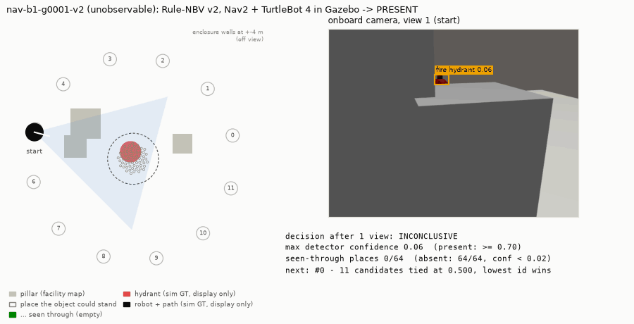
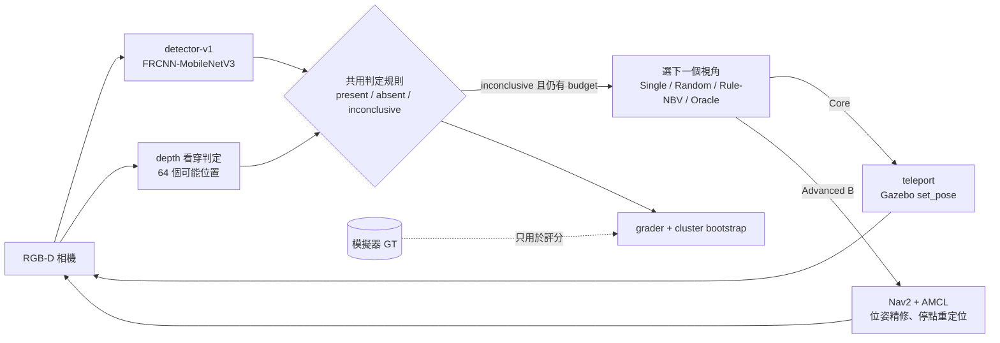
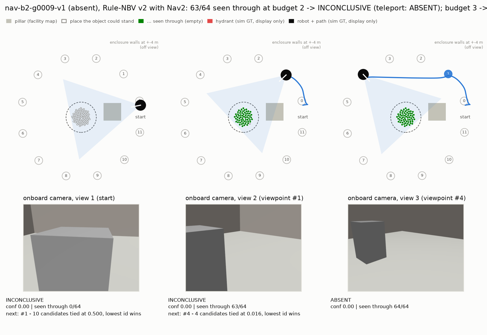
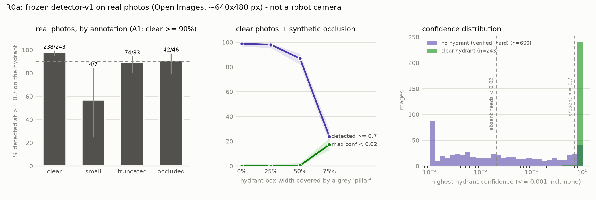

# Inspection Robot + Active Perception

巡檢機器人「沒看到」目標，不等於目標「不存在」，也可能只是被擋住了。
本專案研究：在固定的觀測次數（viewpoint budget）內，主動選擇下一個視角，能不能比單一視角或隨機移動更可靠地判斷目標是
`present`、`absent` 還是 `inconclusive`，而且不把漏看當成不存在。

> **狀態（2026-10-14）**
> - Core（v1、v2）已結案；Advanced B（Nav2 實際導航）已完成。Advanced C（RL）由使用者決定不做。
> - R0 真實環境適應研究（不是實機驗證）：**R0a 真實照片上的 detector 檢查已完成**——清楚可見的消防栓 97.9% 認得出來，
>   但外觀相近的物體有 9.2% 被誤判（判準未通過）；R0b（depth 雜訊與定位誤差的模擬測試）進行中。
> - **所有結果都只在 ROS 2 Jazzy + Gazebo Harmonic 模擬中取得，尚未在實體機器人或真實影像上驗證**（見[驗證範圍](#驗證範圍模擬已驗證--實機未驗證)）。
> - 未通過的 Gate 與失敗都照實保留：v1「接近 Oracle」在 holdout 沒有重現；v2 在 budget 2 未接近 Oracle；
>   v2 的改善主要來自 absent 判定規則，**不是**選視角策略。

**English summary.** A simulated inspection robot must decide whether a target (a fire hydrant) is present, absent, or
undecidable within a fixed number of views, where pillars may hide it. A depth-based rule that only answers `absent`
once every place the object could stand has been *seen through* removes false absents in all methods. A rule-based
next-best-view policy beats single-view and random baselines, also when a TurtleBot 4 really drives there with Nav2,
provided its pose is refined against the facility map. Every number comes from Gazebo. Nothing has been validated on
real hardware or real images. Experiments were pre-registered, and every formal test set was used once and then sealed.



*Demo（開發資料 `nav-b1`，`./docker/demo.sh` 的實際輸出）：*
1. 起點時消防栓被柱子擋住，判定 `inconclusive`。
2. Rule-NBV v2 選下一個視角，TurtleBot 4 用 Nav2 開過去，到點後用 depth 對設施地圖重定位，再拍攝。
3. 第二個視角仍被擋：起點幾乎看不到 zone，11 個候選同分，按編號選了 #0。這是 rule-nbv-v2 的[已知限制](docs/failure-analysis.md#4-為什麼-rule-nbv-v2-沒有顯著貢獻分數平手時按編號選開發資料)。
4. 第三個視角看到消防栓，判定 `present`（confidence 0.99）。

左圖的路徑與消防栓位置來自模擬器真實值，只用於畫圖。

## 重點結果（R0a 為真實照片，其餘全部在 Gazebo 模擬中）

| 階段 | 正式評估資料（各只跑一次） | 主要結果 | 需要一起讀的限制 |
|---|---|---|---|
| **Core v1** | `core` test，524 集 | Rule-NBV 在 budget 3 的 accuracy 0.996，Random 0.907、Single 0.202；Rule 的 false absent 為 0 | 「接近 Oracle」在新的 holdout **沒有重現** |
| **Core v2** | `holdout`，600 集 | 四個方法的 false absent 全部是 0；Rule 在 budget 2 從 0.683 → **0.957** | 改善主要來自 **absent 判定規則**；新策略相對 v1 策略 +0.020，不顯著 |
| **Advanced B** | `nav-b2`，160 集、960 次 Nav2 閉迴路 | Nav2 與 teleport 的 accuracy 差 ≤ 0.006；Rule − Random +0.079 [0.044, 0.119]；false absent / 碰撞皆 0 | 需要「位姿精修 + 看穿餘裕 + 停點重定位」；只用 AMCL 位姿時安全邊界會失效 |
| **R0a**（真實照片） | Open Images，383 張含消防栓 ＋ 600 張偏難負樣本 | clear 消防栓 localized recall@0.7 97.9%；自然遮擋 / 截斷下完全漏看 0 / 379 | 偏難負樣本 false present 9.2%（判準 ≤ 1% **未通過**）；網路照片不是機器人相機 |

詳細數字、CI 與 Gate 判定在下方[結果](#結果)。所有決策與判準見 [docs/decisions/](docs/decisions/)（001–019）：會影響結論的設計、判準與統計方法都在看結果前寫成；記錄結果的 decision（010、013、019 等）都標明是看過結果後寫的。

## 驗證範圍：模擬已驗證 / 實機未驗證

| 項目 | 模擬中已驗證 | 實機尚未驗證 |
|---|---|---|
| 感知 | Gazebo 的消防栓模型 + `detector-v1`（COCO 預訓練、未微調）；可見像素 ≥ 10k 時偵測率 99.8%。**真實照片（R0a）**：clear 97.9%，但偏難負樣本誤報 9.2% | 機器人相機的影像（俯角、距離、動態模糊、曝光）；真實巡檢現場的誤報率 |
| Depth | Gazebo planar depth，與解析 ray-cast 的中位誤差 0.25 mm | 真實 RGB-D 的雜訊與缺值；v2 看穿判定的 3 cm 容忍值是否仍安全 |
| 定位 | AMCL + 以 depth 對已知設施地圖精修（p95 約 0.3 cm）；起點已知，里程計接近理想 | 里程計漂移、地圖誤差、特徵不足的場地、人員等動態障礙 |
| 導航 | TurtleBot 4 + Nav2 在 8 m 圍牆、方柱場景：440 / 440 準確到點，碰撞 0 | 真實地面、窄通道、電池與時間限制 |
| 場景 | 方柱遮擋、固定光照、單一目標類別、固定 2.0 m 的視角環與 1.1 m 桅桿相機 | 真實設施的幾何與目標物 |
| 評分 | 模擬器真實位姿與標籤 | 需要獨立的真值量測（例如 motion capture、AprilTag），才能量定位誤差與 false absent |

往實機的建議路徑見 [docs/roadmap-real-inspection.md](docs/roadmap-real-inspection.md)（**尚未啟動**）。

## 任務


- 目標：Gazebo Fuel 的消防栓（COCO `fire hydrant`），放在半徑 0.5 m 的 inspection zone 裡；1–3 根方柱可能擋住視線。
- 三種真實狀態：`visible`（初始視角看得到）、`unobservable`（存在但被擋住）、`absent`（不存在）。
- 單一視角時，被擋住的消防栓與根本沒有消防栓幾乎無法分辨（pilot AUROC 0.75）。
- 每集有 12 個環繞 zone 的候選視角，只由 zone 與場景 seed 決定，與物件和遮擋無關（leakage tests）。初始視角算第 1 次觀測。

| Policy | 可用資訊 | 角色 |
|---|---|---|
| Single View | 初始視角 | baseline |
| Random NBV | 候選集合、seed | baseline |
| Rule-based NBV | 已拍攝視角的 depth（v1：障礙高度圖預測 zone 可見度；v2：已知 / 未知地圖預測可看穿的位置） | 受測方法 |
| Oracle NBV | 模擬器 GT | 上限，不可部署 |

四個方法共用同一條判定規則與同一個 detector，差別只在「選了哪些視角」。

- **`decision-v1`**：
  - `present`：confidence ≥ 0.7。
  - `absent`：≥ 2 個方位扇區（共 8 個）有「zone 至少 30% 未被擋」的視角，且所有 confidence < 0.05。
- **`decision-v2`**：
  - `absent`：zone 內 64 個「物件可能站立的位置」都被某個視角的 depth **看穿**，且所有 confidence < 0.02。
  - 物件真正站的位置不可能被看穿，所以即使 detector 漏看，也不會 false absent。
- 其餘一律 `inconclusive`。

## 系統架構



- **Core** 用 render-then-replay：每個視角在 Gazebo 只 render 一次，四個方法 replay 同一份觀測，所以方法之間的差異只來自選視角。
  ROS 2 inspector node 的線上執行與 replay 完全一致（pilot：v1 192 / 192、v2 168 / 168）。
- **Advanced B** 每個（episode, 方法, seed）啟動一個獨立容器：TurtleBot 4 + 1.1 m 桅桿相機、Nav2 1.3.13、AMCL。
  判定只用 AMCL 估計位姿、機載影像、detector 與設施地圖（牆、柱子，**不含目標物**）。
- 完整架構、資訊邊界與模組對照：[docs/architecture.md](docs/architecture.md)。

## 結果

所有正式評估都是：先寫好 decision log（協定、判準、統計方法），再在未參與開發的資料上只跑一次。`holdout` 與 `nav-b2` 是在協定寫好之後才產生的。
95% CI 為以 scene group 為 cluster 的 bootstrap（1000 次）；Random 為多個 run seeds 的平均。

### Core v1（`core` test：131 scene groups、524 episodes；decision 010）

| budget | Single View | Random NBV | **Rule-based NBV v1** | Oracle NBV（上限） |
|---|---|---|---|---|
| 1 | 0.202 [0.16, 0.25] | 0.202 | 0.202 | 0.202 |
| 2 | 0.202 | 0.620 [0.58, 0.66] | **0.706 [0.66, 0.75]** | 0.710 [0.67, 0.75] |
| 3 | 0.202 | 0.907 [0.89, 0.92] | **0.996 [0.99, 1.00]** | 1.000 |
| 5 | 0.202 | 0.998 [0.996, 1.000] | **1.000** | 1.000 |

| 成對差異（同一批 episodes） | budget 2 | budget 3 |
|---|---|---|
| Rule − Random，accuracy | **+0.086 [0.072, 0.101]** | **+0.089 [0.069, 0.108]** |
| Rule − Random，inconclusive rate | −0.085 [−0.100, −0.071] | −0.088 [−0.107, −0.068] |
| Rule − Single，accuracy | +0.504 [0.49, 0.52] | +0.794 [0.75, 0.83] |
| Oracle − Rule，accuracy | +0.004 [0.000, 0.011] | +0.004 [0.000, 0.011] |


- **Single View 從不給出錯誤的肯定答案，但 80% 的時候只能說「不知道」**：
  - 共用的判定規則不會把「沒看到」當成 `absent`。
  - 所以單一視角在 unobservable 與 absent episodes 一律 `inconclusive`（false-absent = 0）。
- **主動換視角把 inconclusive 變成正確答案**：
  - Rule-based NBV 用已走訪視角的 depth 建出 zone 外障礙物高度圖，預測每個候選視角能看到多少 inspection zone。
  - budget 3 時 accuracy 0.996（Random 0.907），平均只用 2.09 個視角。
- **已接近上限**：Oracle（讀模擬器 GT）只多 0.004；依 SPEC 的 Gate，**不需要 RL**。
  - 補註：這個「接近 Oracle」在新的 holdout 上**沒有重現**，差距為 0.028–0.032（見 v2 段落與 decision 013；原紀錄不改）。

| false-absent / false-present | Single | Random | Rule | Oracle |
|---|---|---|---|---|
| false-absent rate（budget 2 / 3 / 5） | 0 / 0 / 0 | 0.0015 / 0.0015 / 0.0015 | **0 / 0 / 0** | 0 / 0 / 0 |
| false-present rate | 0 | 0 | 0 | 0 |

Random 的 false absent 只發生在 `core-g0103-v0`（seeds 3、4）：隨機挑到兩個「zone 大致看得到、但消防栓剛好被柱子擋住」的視角。

| GT 狀態（n），budget 2 / 3 | Single | Random | Rule | Oracle |
|---|---|---|---|---|
| visible（105） | 1.00 / 1.00 | 1.00 / 1.00 | 1.00 / 1.00 | 1.00 / 1.00 |
| unobservable（157） | 0.006 / 0.006 | 0.851 / 0.978 | **0.987 / 1.000** | 1.00 / 1.00 |
| absent（262） | 0 / 0 | 0.329 / 0.827 | **0.420 / 0.992** | 0.420 / 1.000 |

budget 2 的 absent 上限是 0.420：若初始視角的 zone 被擋，兩個視角湊不到 decision-v1 要求的兩個有效扇區，Oracle 也一樣。


- Rule-based NBV 在 budget 2 / 3 共 156 件未答對，其中 152 件是上述 budget 結構限制。
- 真正的策略失敗只有 4 件，全在 scene group `core-g0298`：
  - 初始視角看不到藏在前一根柱子後面的第二根柱子。
  - 高度圖把未觀測區域當成空的，因此選到被擋的視角。

**Detector（`detector-v1`）**：
- 選型：在獨立的 `detsel` 資料比較 YOLOv8m、YOLO11m、torchvision Faster R-CNN MobileNetV3。
  三者 presence AUROC 都是 1.000、AP50 0.995–0.996，預先登錄的規則因此由授權（BSD vs AGPL）決定，選 **FRCNN-MobileNetV3**（[decision 005](docs/decisions/005-detector-selection-protocol.md)）。
- test frame 上，可見消防栓像素 ≥ 10k 時偵測率 99.8%；< 5k 時幾乎偵測不到。在這個模擬場景中，**瓶頸是視角，不是 detector**。

### Core v2：未觀察區域不再被當成 absent（`holdout`：150 scene groups、600 episodes；decision 011–013）

- **動機**：v1 判 absent 的依據（「≥ 2 個有效扇區」）只是代理指標；消防栓若剛好站在沒被看到的位置，仍可能被判 absent（v1 test 上 Random 出現過一次）。
- **開發方式**：v2 經使用者核准開發，**只用 core train / val 設計與調參**，原 test 封存不用。
- **評估方式**：在新產生、未參與開發的 `holdout` 上，與 v1 一起各跑一次。
- **`rule-nbv-v2`**：優先選能看穿尚未看穿位置的視角；用 depth 建出已知障礙 / 已知空 / 未知地圖，經過未知空間的視線只給一半信任（v1 視為一定空）。


| holdout（600 episodes） | budget 2 | budget 3 | budget 5 |
|---|---|---|---|
| v1 Rule | 0.683 [0.64, 0.73] | 0.968 [0.95, 0.99] | 1.000 |
| **v2 Rule** | **0.957 [0.93, 0.98]** | **0.998 [0.995, 1.000]** | 1.000 |
| v2 Rule − v1 Rule | **+0.273 [0.228, 0.317]** | **+0.030 [0.010, 0.052]** | 0 |
| v2 Random / Single | 0.868 / 0.392 | 0.975 / 0.392 | 0.998 / 0.392 |
| v2 Oracle | 1.000 | 1.000 | 1.000 |

- **安全**：v2 所有方法、所有 budget 的 false-absent 都是 0（v1 Random 0.07%）；「物件沒被看到卻滿足 absent 幾何條件」的情況為 0。
- **校準**：definitive decision 的 ECE 從 0.21–0.38 降到 ≤ 0.008（absent 的 confidence 改為看穿比例）。
- **改善來自哪裡（消融）**：判定規則 +0.253 [0.215, 0.293]（budget 2）；新策略相對 v1 策略只多 +0.020 [−0.020, 0.058]，**不顯著**。
- **v1 結論的重現**：holdout 上 v1 Rule 仍穩定勝過 Random（+0.075 / +0.070），但 Oracle − Rule = 0.028 / 0.032，**原 test 的「接近 Oracle」沒有重現**。
- **v2 與上限的差距**：budget 2 時 Oracle 高 0.043 [0.020, 0.070]，可歸因於視角選擇；budget 3 只差 0.002。
- **殘餘失敗**：27 件全部是 `inconclusive`，沒有錯誤的肯定答案。原因是 budget 2 的兩個視角看不穿全部位置，或只看到消防栓一小部分（弱偵測 < 0.7）。
- ROS 2 線上執行 v2：pilot 上 168 / 168 與 replay 相同（[`results/pilot-v2/`](results/pilot-v2/)）。

### Gate 總表（decision 009 §4 判準原樣套用；decision 014）

| Gate | v1 @ 原 test | v1 @ holdout | v2 @ holdout |
|---|---|---|---|
| 1. Rule 穩定勝過 Random / Single | 通過 | 通過 | 通過 |
| 2. 非 leakage | 通過 | 通過 | 通過 |
| 3. 可重現的殘餘失敗 | 通過（156） | 通過（209） | 通過（27，全部 `inconclusive`） |
| 4. Rule 接近 Oracle | 是（0.004） | **未通過**（0.028 / 0.032） | **budget 2 未通過**（0.043 [0.020, 0.070]）；budget 3 通過 |

**未通過 / 未成立的項目**：
- v1「接近 Oracle」在 holdout 未重現。
- v2 在 budget 2 未接近 Oracle：依 SPEC，RL 的停止條件不成立，但使用者決定暫不做 Advanced C。
- rule-nbv-v2 相對 rule-nbv-v1 沒有顯著改善。
- v2 相對 v1 有 7 件（budget 2）與 1 件（budget 3）退步，全部變成 `inconclusive`。

### 改善來自判定規則，不是選視角策略


- **v1 在 budget 2 的失敗約 90% 是結構性的**（Oracle 也答不出來）：decision-v1 要兩個有效扇區，初始視角被擋時 budget 2 不可能湊齊。
  decision-v2 只要一個視角看穿全部候選位置就夠，**結構性失敗 173 → 0**。
- **兩個改變的成對比較**：只換判定規則，修好 152 件、弄壞 0 件；只換策略，修好 31 件、弄壞 19 件（淨 +0.020，不顯著）。
- **原因**（開發資料上確認）：初始視角被擋時，rule-nbv-v2 有 75–81% 的第二視角決策是分數平手，由候選編號決定。
  這是凍結 v2 的已知限制，不在 Core 修正；修正屬於 v3，需要新的資料。

### Advanced B：真正導航下的 active perception（decision 015–019）

- **設定**：把 teleport 換成 **Nav2 實際導航**。TurtleBot 4 加 1.1 m 桅桿相機（內參同 Core），用 AMCL 定位、Nav2 規劃與控制。
  判定規則、視角策略、detector 都用 Core 凍結的 v2；真實位姿與標籤只用於評分。
- **到點後的處理**：以機載 depth 對設施地圖精修位姿、回饋 AMCL 重定位；判定時對剩餘位姿誤差取保守值。
- **正式評估**：新的 `nav-b2`（160 集：absent 80、unobservable 38、visible 42），在 decision 018 預先登錄後只跑一次，同一批 episodes 另做 teleport 對照。


| `nav-b2`（160 集、960 次閉迴路） | budget 2 | budget 3 |
|---|---|---|
| Rule-NBV v2：teleport / Nav2 | 0.988 / **0.981** | 1.000 / **1.000** |
| Random（3 seeds）：teleport / Nav2 | 0.908 / 0.902 | 0.981 / 0.983 |
| Single / Oracle（Nav2） | 0.525 / 1.000 | 0.525 / 1.000 |
| Nav2 − teleport（Rule） | −0.006 [−0.019, 0.000] 不劣於 | 0.000 |
| Rule − Random（Nav2） | **+0.079 [0.044, 0.119]** | **+0.017 [0.004, 0.033]** |
| Rule − Single（Nav2） | +0.456 [0.306, 0.613] | +0.475 [0.325, 0.650] |

- **Q1 安全**：Nav2 下所有方法、所有 budget 的 false absent、false present、「物件存在卻算成全部看穿」都是 0。
- **Q2 導航的影響**：四個方法都不劣於 teleport（最低 CI 下界 −0.019，預先登錄的邊界 −0.05）。
- **Q3 主動視角**：在 Nav2 下仍顯著勝過 Single 與 Random。
- **Q4 成本**：Rule 每集比 Random 少走 0.46 m [0.14, 0.80]、少 2.6 s（模擬時間）。
- **導航**：440 次全部準確到點（reachable viewpoint 100%），碰撞 0、逾時 0；每次導航（含重定位）模擬時間 p50 22 s。
- **限制**：全部在 Gazebo；里程計接近理想，起始位姿與設施地圖已知；場景（圍牆、固定視角環）與 Core 不同，**數字不能和 Core 直接比**。
  細節：[`results/nav-b2/`](results/nav-b2/README.md)、[decision 019](docs/decisions/019-b2-result-and-advanced-b-closure.md)。

#### 走到 B2 之前：B0 可行性驗證、兩次未通過與修正


| 資料（各只跑一次） | 結果 | 判定 |
|---|---|---|
| `nav-b0`：只用 AMCL 位姿 | RTF 0.999；準確到點 91.7%；AMCL 誤差 p95 7.6 cm / 0.039 rad；168 組判定錯誤答案 0 | **安全邊界未通過**：2 / 6 個物件存在的 episode 在所有視角聯集後被算成全部看穿（這次靠 detector 看到才答對） |
| `nav-b0c`：+ 位姿精修 + 看穿餘裕（decision 016） | 判定用位姿誤差 p95 0.32 cm / 0.0005 rad；聯集風險 3 / 6 → **0 / 6**；錯誤答案 0 | **準確到點 86.1% 未通過**（門檻 90%）：Nav2 依 AMCL 判定到點，真實朝向差到 0.10–0.12 rad |
| `nav-b0d`：+ 停點視角重定位（使用者指示再試一次） | 準確到點 **144 / 144**；重定位後定位誤差 p95 0.42 cm / 0.0021 rad；錯誤答案、geometric risk、聯集風險皆 0 | **全部通過**；代價：餘裕讓 7 / 84 個 absent 組合變成 `inconclusive`（安全方向） |

- B0 的意義：**v2「漏看不會判 absent」的保證依賴位姿精度**。用估計位姿時必須先精修，並對剩餘誤差保守。
- 之後的步驟：B1 閉迴路整合在開發資料 `nav-b1` 上完成（[`results/nav-b1/`](results/nav-b1/README.md)），然後才做 B2。
- 細節：[`results/nav-b0/`](results/nav-b0/README.md)、[`nav-b0c/`](results/nav-b0c/README.md)、[`nav-b0d/`](results/nav-b0d/README.md)、
  [decision 016](docs/decisions/016-b0-pose-refinement-and-margin.md)；當時的可行性評估原文：[docs/advanced-b-nav2-evaluation.md](docs/advanced-b-nav2-evaluation.md)。

#### 導航的代價與失敗案例


- **距離**：Rule 省下的距離主要來自 unobservable（3.26 m vs 4.25 m）與 absent（1.68 m vs 2.13 m）episodes。
- **時間**：停點重定位有 92.5% 用滿 2 次修正；每個目標的導航時間從 13.4 s（不需修正）增加到 22.3 s（修正 2 次）。結果正確，但慢。



- 正式 budget 下，teleport 與 Nav2 對錯不同的只有 5 件，**沒有一件變成錯誤答案**。上圖是 Rule 唯一的一件：
  - Nav2 的第二個停點只看穿 63 / 64 個位置：位姿餘裕讓一個位置不被計入。
  - 因此 budget 2 時為 `inconclusive`；teleport 在 budget 2 就答 `absent`，Nav2 在 budget 3 也答對。
- 另外兩件（Random）是**接近門檻的偵測**：消防栓只露出約四分之一，teleport 的 confidence 為 0.71 / 0.76，Nav2 停點偏差幾公分後降到 0.48 / 0.39。
- 逐件分析：[docs/failure-analysis.md Part B](docs/failure-analysis.md#part-b--advanced-bnav2)。

### R0：真實環境適應研究（decision 020–）

使用者決定先不買機器人、不做 RL，改用兩個不需要硬體的步驟，回答往實機前最大的兩個風險。三種驗證刻意分開，不混為一談：

| 名稱 | 內容 | 狀態 |
|---|---|---|
| **R0a 真實影像驗證** | 網路上的真實照片 ＋ 凍結的 detector 與門檻 | **完成**（decision 021） |
| R0b 模擬雜訊測試 | Gazebo 影像 ＋ 依感測器規格建模的 depth 雜訊與定位 / 校正誤差 | 進行中（decision 022） |
| 實機驗證 | 實體機器人、實際場地 | **未做** |



**R0a**：判準在跑 detector 之前凍結。資料是 Open Images V7 的 983 張照片：383 張含消防栓、600 張人工確認不含的偏難負樣本，影像只存在本機。
與 COCO（detector 的訓練來源）重疊的照片已排除。評估時把影像縮到約 640×480 像素數，與模擬相機相同。

| 判準 | 結果 | 判定 |
|---|---|---|
| A1 清楚可見的消防栓，在框上偵測到 ≥ 0.7 | 238 / 243 = 97.9% [95.3, 99.1] | 通過 |
| A2 偏難負樣本被判成 present | 55 / 600 = 9.2% [7.1, 11.7]（門檻 ≤ 1%） | **未通過** |
| A3 偏難負樣本的 absent 被擋下（最高信心 ≥ 0.02） | 47.8% | **不可用**（只會 `inconclusive`，不影響安全） |

- **幾乎不會完全漏看**：自然遮擋、截斷、小目標中，最高信心 < 0.02 的是 0 / 379。
  人工遮住消防栓寬度的 75% 時才出現完全漏看（17.3%），這時只能靠 depth 看穿判定避免 false absent（R0b 的問題）。
- **誤報來自外觀相近的物體**：紅色郵筒、閥門與立管、路樁、玩具。
- **判定規則有結構弱點**：取整張影像的最高信心，不管偵測框是否在 inspection zone 內。模擬場景沒有干擾物，所以之前從未暴露。
  實機之前必須先處理，例如只計入落在 zone 內的偵測，或用真實影像微調。兩者都屬新版本，需要使用者決定。
- 細節：[`results/r0a/`](results/r0a/README.md)、[decision 020](docs/decisions/020-r0-real-world-adaptation-and-r0a-protocol.md) / [021](docs/decisions/021-r0a-result.md)。

## 失敗分析（摘要）

完整內容：[docs/failure-analysis.md](docs/failure-analysis.md)。都是事後、唯讀的分析，不重跑正式評估，也不回饋到凍結參數。

| 發現 | 影響 | 處理 |
|---|---|---|
| Rule 的每一個失敗都是 `inconclusive`，從未給出錯誤的肯定答案（v1、v2、Nav2） | 失敗只發生在安全方向 | — |
| v1 在 budget 2 的失敗約 90% 是判定規則的結構限制（Oracle 也失敗） | v2 改判定規則後消失 | decision-v2 |
| rule-nbv-v2 在初始視角被擋時 75–81% 分數平手、按編號選 | v2 策略沒有顯著貢獻；Demo 中可見 | 記錄為限制（v3 需新資料） |
| v2 的殘餘失敗集中在 3 根柱子的場景（19 / 26） | 視角選擇仍有改進空間 | 記錄為限制 |
| 只用 AMCL 位姿時，看穿判定可能「穿過」物件位置 | 安全保證失效 | decision 016：位姿精修 + 餘裕 + 重定位 |
| 部分可見時，偵測 confidence 對公分級的停點偏差很敏感 | Nav2 下多出 2 件 `inconclusive` | 記錄；實機需量測 |
| 起點視角的位姿精修在 3 / 40 個場景一律退化 | 改用較寬的餘裕；沒有造成錯誤答案 | 記錄 |
| 停點重定位 92.5% 用滿修正次數 | 每個目標約多 9 秒 | 記錄（改進屬新版本） |
| 真實照片中外觀相近的物體被判成 present（R0a，9.2% 的偏難負樣本） | 錯誤的肯定答案風險；判定規則不檢查偵測框是否在 zone 內 | 記錄；修正屬新版本（需使用者決定） |

## 研究紀律

這個專案刻意用「不容易騙自己」的方式進行：

- **先寫判準、再看結果**：19 份 decision log 記錄每個會影響結論的決定，標明是否在看過結果後才寫。調參只用 train，val 只檢查。
- **正式評估只跑一次**：`core` test、`holdout`、`nav-b2` 都用過一次後封存。
  `SEALED.sha256` 釘住所有已 commit 的結果、凍結的 episode sets 與凍結設定，`tests/test_seal.py` 檢查；正式 runner 對封存資料只允許 `--reproduce`。
- **v2 是看過 v1 test 後才提出的**：所以它的所有宣稱只來自新的 holdout，原 test 不用於 v2。
- **未通過的 Gate 照實寫**：v1 的「接近 Oracle」沒有重現，v2 在 budget 2 未接近 Oracle，B0 兩次未通過，全部保留在 README 與 decision log。
- **GT 不進判定**：候選視角與物件無關（leakage tests）；Advanced B 的判定只用 AMCL 估計位姿、機載影像與不含目標物的設施地圖。
- **可驗證的重現**：
  - 所有 spec 都能逐位元重新產生。
  - 封存的 test / holdout 結果用 `--reproduce` 逐位元相同（2026-10-14 重新確認）。
  - Demo 工具會比對重建的判定輸入與執行紀錄。

## 重現

```bash
uv sync --extra detectors && uv run pytest              # 不需 Docker
uv run python -m activeperception.seal verify           # 封存的結果與凍結設定未被改動
./docker/build.sh && ./docker/build_nav.sh && ./docker/build_navdet.sh
./docker/demo.sh                                        # 一集 Nav2 閉迴路 + 動畫（約 1–1.5 分鐘）
```

從「不需 Docker 的檢查」到「完整重跑 Core 與 Advanced B」的四個層級、所需時間與封存資料的逐位元比對，見 [docs/reproduce.md](docs/reproduce.md)。
平台版本與 image digest：[docs/platform/versions.md](docs/platform/versions.md)、[versions-nav.md](docs/platform/versions-nav.md)。
GPU 工作（detector 選型與 Core 偵測）在共享的 RTX 5070 Ti 上執行，遵守 GPU lock（[MACHINE_POLICY.md](MACHINE_POLICY.md)）。

## 限制

**場景與感知**
- 場景刻意簡化（方柱遮擋、固定光照、單一目標類別）。detector 在這個 world 幾乎不誤報，perception 偏容易。

**判定規則與策略**
- `decision-v1` 的 absent 規則較寬：test 上 Random 出現一例 false absent，Rule / Oracle 沒有。
- 多視角方法的 definitive decision confidence 校準不佳（v1 ECE 0.21–0.38；Single 0.016）：absent 的 confidence = coverage × (1 − c_max)，公式在 v1 凍結未改。v2 已改善。
- rule-nbv-v2 在初始視角被擋時常常分數平手、按候選編號選（failure analysis §4）。v2 的改善不應被理解為選視角策略的進步。

**資料使用**
- v2 是看過 v1 test 後提出的改進；它的所有宣稱只來自 holdout。
- holdout、原 test 與 `nav-b2` 都已用過；任何新版本都需要新的、未參與開發的資料。

**Advanced B**
- 只在 Gazebo 模擬中：里程計接近理想，起始位姿與設施地圖已知，設施有圍牆提供定位特徵。
- 場景與 Core 不同（`gen-nav-v1`），數字不能直接比較。
- 停點重定位讓多數目標的導航時間從 13.4 s 增加到 22.3 s（p50，模擬）。

**實機**
- 沒有任何實體機器人或真實影像的結果（見[驗證範圍](#驗證範圍模擬已驗證--實機未驗證)）。

## 後續

- Advanced C（RL）：使用者決定不做。
- 往真實巡檢的建議（不需採購的準備 → 實機 B0 → 實機正式評估）：[docs/roadmap-real-inspection.md](docs/roadmap-real-inspection.md)。
  其中 R0a 已完成、R0b 進行中。
- 任何新階段都需要使用者決定。

## 目錄

```
activeperception/          核心套件：episodes / sim（gz_client、render、replay、raycast）/ sensing / decision /
                           policies / harness / grader / metrics / detector / tune / experiment(_v2) / seal / failure_analysis
activeperception/nav/      Advanced B：gen-nav 場景與地圖、TurtleBot 4 桅桿相機、位姿精修與餘裕、B0 / B1 driver、分析、失敗分析
ros_ws/src/inspection_ap_ros/   ROS 2 package（inspector node、launch）
docker/                    映像（sim / ros / nav / navdet）、render、smoke、ROS 線上執行、Nav2 批次、demo.sh
tools/                     make_figures.py（README 圖表）、make_demo.py（Demo 動畫與分鏡）
gazebo/models/             vendored Fuel 模型（fire_hydrant，CC0）
data/episodes/             凍結的 spec / episode sets（含 GT）：core、pilot、detsel、holdout、nav-b1、nav-b2
results/                   detector 選型、pilot、調參、v1 test、holdout、failure analysis、nav-b0* / nav-b1 / nav-b2、nav failure analysis
docs/decisions/            decision logs 001–022（020– 為 R0）
activeperception/r0a.py    R0a：真實照片的選樣、下載、偵測、報告
activeperception/r0b*.py   R0b：depth / 位姿誤差模型與雜訊條件下的 replay
docs/architecture.md       系統架構與資訊邊界
docs/failure-analysis.md   失敗分析（Part A Core、Part B Nav2）
docs/reproduce.md          重現指南（四個層級）
docs/roadmap-real-inspection.md   往真實巡檢的後續建議（未啟動）
SEALED.sha256              封存檔案的 sha256（tests/test_seal.py 檢查）
```

研究定義：[SPEC.md](SPEC.md)。實驗規範：[docs/EXPERIMENT_RULES.md](docs/EXPERIMENT_RULES.md)。進度紀錄：[NEXT.md](NEXT.md)。
