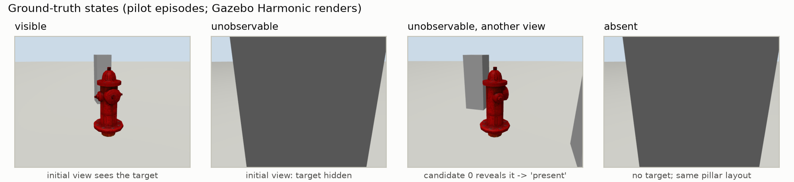
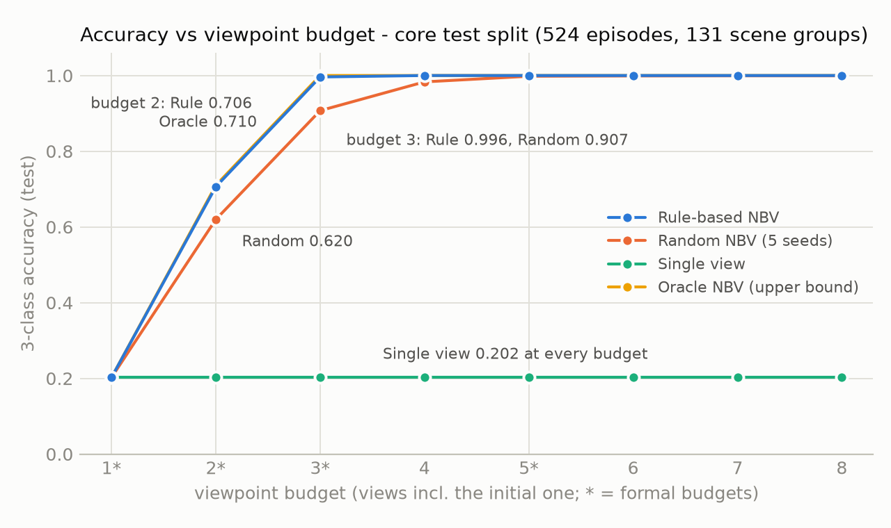
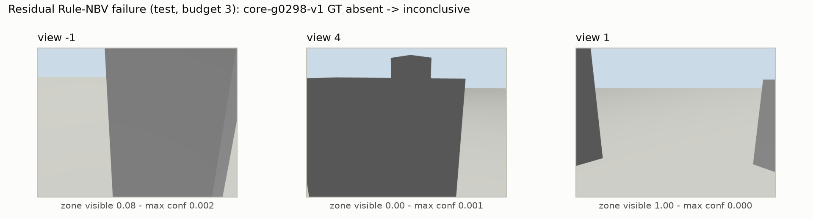
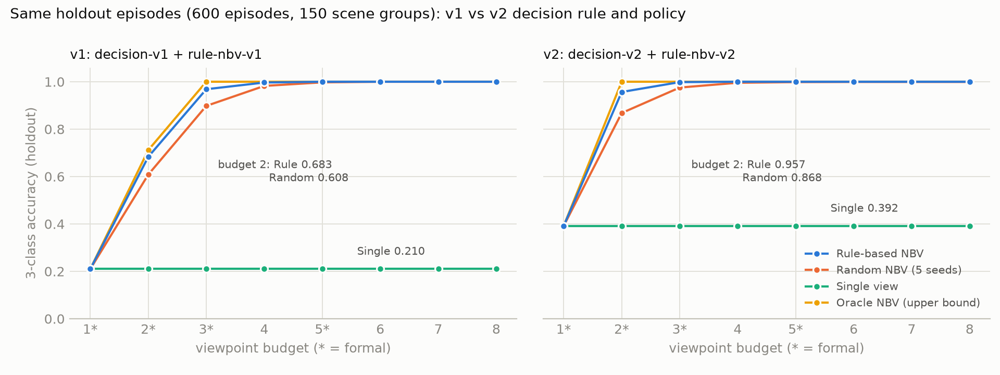
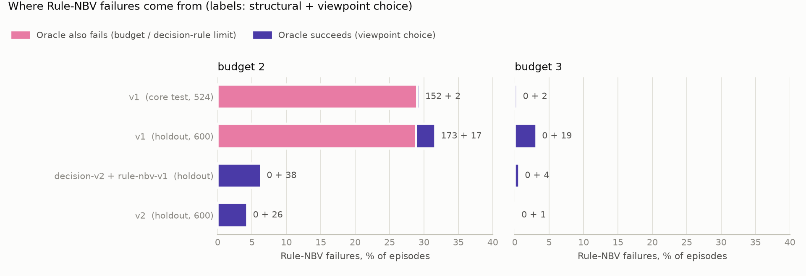
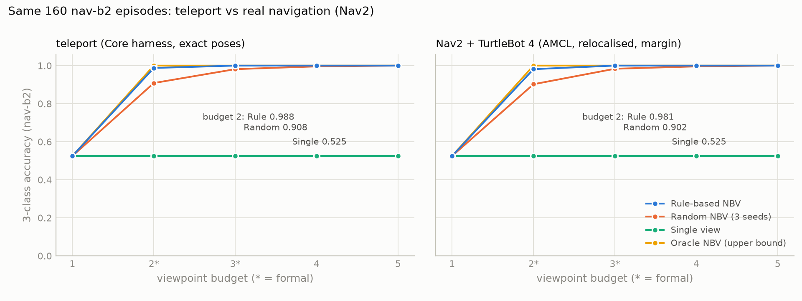

# Inspection Robot + Active Perception

> **狀態（2026-10-13）**
> - **v1（Core）**：正式 test 跑完一次，Gate 已判定（[decision 010](docs/decisions/010-core-test-result-and-gate.md)）——Rule-based NBV 穩定勝過 Single View 與 Random。
> - **v2（看過 v1 test 後的改進）**：只用開發資料設計與調參，在全新的 holdout 上與 v1 分開比較（[decision 011–013](docs/decisions/013-holdout-v1-v2-result.md)）——
>   absent 改成需要「看穿每個可能位置」的空間證據：所有方法 false-absent = 0、Rule 在 budget 2 從 0.683 → 0.957。
>   holdout 也顯示 v1 在原 test 上「接近 Oracle」的結論**沒有重現**，而 v2 在 budget 2 與 Oracle 仍差 4.3 點（見下方 v2 段落）。
> - **Core 已結案**（[decision 014](docs/decisions/014-core-closure.md)）：v2 的改善主要來自 absent 判定規則，**不是**選視角策略；
>   Gate 未通過的項目、失敗分析與資料封存見下方「Core 結案」。Advanced C（RL）暫不進行；Advanced B（Nav2）已完成評估，待決定。
> - **Advanced B（Nav2）完成**（[decision 015–019](docs/decisions/019-b2-result-and-advanced-b-closure.md)）：TurtleBot 4 用 Nav2 實際導航到視角，
>   在新的 160 集正式評估中，所有方法 false absent = 0、準確率與 teleport 相同（差 ≤ 0.006）、Rule 仍勝過 Single / Random 且走得更少。
>   前提是加上 B0 發現必要的「位姿精修 + 看穿餘裕 + 停點重定位」。全部在模擬中。
> - 正式數字只來自 ROS 2 Jazzy + Gazebo Harmonic；synthetic world 只用於 correctness tests。

## 一句話問題

在物件可能「可見、被遮擋、根本不存在」的 inspection task 中，active perception 能不能在固定觀測預算下，
比單一視角與隨機移動更可靠地判斷 `present / absent / inconclusive`？

完整研究定義見 [SPEC.md](SPEC.md)，實驗規範見 [docs/EXPERIMENT_RULES.md](docs/EXPERIMENT_RULES.md)，
所有會影響結論的設計決策（全部在看結果前寫成）見 [docs/decisions/](docs/decisions/)。



巡檢目標是 Gazebo Fuel 的消防栓（COCO `fire hydrant`），放在半徑 0.5 m 的 inspection zone 裡；1–3 根方柱可能擋住視線。
「沒偵測到」不等於 `absent`：單一視角時，被擋住的消防栓與根本沒有消防栓幾乎無法分辨（pilot AUROC 0.75）。

## v1 結果（`core` test split：131 scene groups、524 episodes）

Accuracy（3 類），95% CI 為以 scene group 為 cluster 的 bootstrap（1000 次）；Random NBV 為 5 個 run seeds 平均。

| budget | Single View | Random NBV | **Rule-based NBV v1** | Oracle NBV（上限） |
|---|---|---|---|---|
| 1 | 0.202 [0.16, 0.25] | 0.202 | 0.202 | 0.202 |
| 2 | 0.202 | 0.620 [0.58, 0.66] | **0.706 [0.66, 0.75]** | 0.710 [0.67, 0.75] |
| 3 | 0.202 | 0.907 [0.89, 0.92] | **0.996 [0.99, 1.00]** | 1.000 |
| 5 | 0.202 | 0.998 [0.996, 1.000] | **1.000** | 1.000 |

| 成對差異（同一批 episodes） | budget 2 | budget 3 |
|---|---|---|
| Rule − Random，accuracy | **+0.086 [0.072, 0.101]** | **+0.089 [0.069, 0.108]** |
| Rule − Random，inconclusive rate | −0.085 [−0.100, −0.071] | −0.088 [−0.107, −0.068] |
| Rule − Single，accuracy | +0.504 [0.49, 0.52] | +0.794 [0.75, 0.83] |
| Oracle − Rule，accuracy | +0.004 [0.000, 0.011] | +0.004 [0.000, 0.011] |



- **Single View 從不給出錯誤的肯定答案，但 80% 的時候只能說「不知道」**：所有方法共用的 decision rule 不會把「沒看到」當成 `absent`，
  所以單一視角在 unobservable 與 absent episodes 一律 `inconclusive`（false-absent = 0）。
- **主動換視角把 inconclusive 變成正確答案**：Rule-based NBV 用已走訪視角的 depth 建出 zone 外障礙物高度圖，
  預測每個候選視角能看到多少 inspection zone；budget 3 時 accuracy 0.996（Random 0.907），平均只用 2.09 個視角。
- **已接近上限**：Oracle（讀 simulator GT）只多 0.004。依 SPEC 的 Gate，**不需要 RL**。
  （補註：這個「接近 Oracle」在新的 holdout 上**沒有重現**，差距為 0.028–0.032，見下方 v2 段落與 decision 013；原紀錄不改。）

### False-absent 分析

| | Single | Random | Rule | Oracle |
|---|---|---|---|---|
| false-absent rate（budget 2 / 3 / 5） | 0 / 0 / 0 | 0.0015 / 0.0015 / 0.0015 | **0 / 0 / 0** | 0 / 0 / 0 |
| false-present rate | 0 | 0 | 0 | 0 |

Random 的 false absent 只發生在 `core-g0103-v0`（seeds 3、4）：隨機挑到兩個「zone 大致看得到、但消防栓剛好被柱子擋住」的視角。
Rule-based NBV 與 Oracle 在 test 上沒有任何 false absent。

### 分層（budget 2 / 3）

| GT 狀態（n） | Single | Random | Rule | Oracle |
|---|---|---|---|---|
| visible（105） | 1.00 / 1.00 | 1.00 / 1.00 | 1.00 / 1.00 | 1.00 / 1.00 |
| unobservable（157） | 0.006 / 0.006 | 0.851 / 0.978 | **0.987 / 1.000** | 1.00 / 1.00 |
| absent（262） | 0 / 0 | 0.329 / 0.827 | **0.420 / 0.992** | 0.420 / 1.000 |

budget 2 的 absent 上限是 0.420：若初始視角的 zone 被擋，兩個視角湊不到 decision rule 要求的兩個有效扇區，Oracle 也一樣。

### 殘餘失敗（可重現）



Rule-based NBV 在 budget 2 / 3 共 156 件未答對：152 件是上述 budget 結構限制；
真正的策略失敗只有 4 件，全在 scene group `core-g0298`——初始視角看不到藏在前一根柱子後面的第二根柱子，
高度圖把未觀測區域當成空的，選到被擋的視角。細節見 [decision 010](docs/decisions/010-core-test-result-and-gate.md)。

### Detector（`detector-v1`）

在獨立的 `detsel` 資料（不是 train / val / test）比較 YOLOv8m、YOLO11m、torchvision Faster R-CNN MobileNetV3：
三者 presence AUROC 都是 1.000、AP50 0.995–0.996，預先登錄的規則因此由授權（BSD vs AGPL）決定 → **FRCNN-MobileNetV3**
（[decision 005](docs/decisions/005-detector-selection-protocol.md)、[`results/detector-selection/`](results/detector-selection/)）。
test frame 上，可見消防栓像素 ≥ 10k 時偵測率 99.8%；< 5k 時幾乎偵測不到——**瓶頸是視角，不是 detector**。

## v2：未觀察區域不再被當成 absent（holdout 評估）

v1 判定 absent 的依據是「≥ 2 個方位扇區有 zone 大致可見的視角」，這只是代理指標：消防栓若剛好站在沒被看到的位置，仍可能被判 absent
（v1 test 上 Random 出現過一次）。v2 由使用者核准開發（2026-10-13），**只用 core train / val 設計與調參，原 test 封存不用**，
並在新產生、未參與開發的 `holdout`（150 scene groups、600 episodes）上與 v1 一起各跑一次。

- **`decision-v2`（四個方法共用）**：zone 內 64 個「物件可能站立的位置」，每個位置必須在某個視角的 depth 中被**看穿**（視線一路到底沒被擋），
  而且所有偵測 confidence < 0.02，才判 `absent`；任何一個位置沒看過就是 `inconclusive`。物件真正站的位置不可能被看穿（depth 先打到物件表面），
  所以即使 detector 漏看也不會 false absent。
- **`rule-nbv-v2`**：優先選能看穿尚未看穿位置的視角；用 depth 建出已知障礙 / 已知空 / 未知的地圖，經過未知空間的視線只給一半信任（v1 視為一定空）。



| holdout（600 episodes） | budget 2 | budget 3 | budget 5 |
|---|---|---|---|
| v1 Rule | 0.683 [0.64, 0.73] | 0.968 [0.95, 0.99] | 1.000 |
| **v2 Rule** | **0.957 [0.93, 0.98]** | **0.998 [0.995, 1.000]** | 1.000 |
| v2 Rule − v1 Rule | **+0.273 [0.228, 0.317]** | **+0.030 [0.010, 0.052]** | 0 |
| v2 Random / Single | 0.868 / 0.392 | 0.975 / 0.392 | 0.998 / 0.392 |
| v2 Oracle | 1.000 | 1.000 | 1.000 |

- **安全**：v2 所有方法、所有 budget 的 false-absent 都是 0（v1 Random 0.07%）；「物件沒被看到卻滿足 absent 幾何條件」的情況為 0。
- **校準**：definitive decision 的 ECE 從 0.21–0.38 降到 ≤ 0.008（absent 的 confidence 改為看穿比例）。
- **改善來自哪裡（消融）**：判定規則 +0.253 [0.215, 0.293]（budget 2）；新策略相對 v1 策略只多 +0.020 [−0.020, 0.058]，**不顯著**——v2 的進步主要是「怎麼判 absent」，不是「怎麼選視角」。
- **v1 結論的重現**：holdout 上 v1 Rule 仍穩定勝過 Random（+0.075 / +0.070），但 Oracle − Rule = 0.028 / 0.032，**原 test 的「接近 Oracle」沒有重現**。
- **v2 與上限的差距**：budget 2 時 Oracle 高 0.043 [0.020, 0.070]，可歸因於視角選擇；budget 3 只差 0.002。
  依 SPEC，「已接近 Oracle → 不需要 RL」在 budget 2 不成立；是否進 Advanced 由使用者決定。
- **殘餘失敗**：27 件全部是 `inconclusive`（沒有錯誤的肯定答案）：budget 2 兩個視角看不穿全部位置，或只看到消防栓一小部分（弱偵測 < 0.7）。

ROS 2 線上執行 v2：pilot 上 168 / 168 與 replay 相同（[`results/pilot-v2/`](results/pilot-v2/)）。

## Core 結案：Gate、失敗分析、資料封存

### Gate 總表（decision 009 §4 判準原樣套用）

| Gate | v1 @ 原 test | v1 @ holdout | v2 @ holdout |
|---|---|---|---|
| 1. Rule 穩定勝過 Random / Single | 通過 | 通過 | 通過 |
| 2. 非 leakage | 通過 | 通過 | 通過 |
| 3. 可重現的殘餘失敗 | 通過（156） | 通過（209） | 通過（27，全部 `inconclusive`） |
| 4. Rule 接近 Oracle | 是（0.004） | **未通過**（0.028 / 0.032） | **budget 2 未通過**（0.043 [0.020, 0.070]）；budget 3 通過 |

**未通過 / 未成立的項目**：v1「接近 Oracle」在 holdout 未重現；v2 在 budget 2 未接近 Oracle（依 SPEC，RL 的停止條件不成立，但使用者決定暫不做 Advanced C）；
rule-nbv-v2 相對 rule-nbv-v1 沒有顯著改善；v2 相對 v1 有 7 件（budget 2）與 1 件（budget 3）退步，全部變成 `inconclusive`。

### 改善來自判定規則，不是選視角策略



- v1 在 budget 2 的失敗約 90% 是**結構性**的（Oracle 也答不出來）：decision-v1 要兩個有效扇區，初始視角被擋時 budget 2 不可能湊齊。
  decision-v2 只要一個視角看穿全部候選位置就夠，**結構性失敗 173 → 0**。
- 只換判定規則：修好 152 件、弄壞 0 件；只換策略：修好 31 件、弄壞 19 件（淨 +0.020，不顯著）。
- 原因（開發資料上確認）：初始視角被擋時，rule-nbv-v2 有 75–81% 的第二視角決策是分數平手，由候選編號決定。
  這是凍結 v2 的已知限制，不在 Core 修正；修正屬於 v3，需要新的資料。

完整分析：[docs/failure-analysis.md](docs/failure-analysis.md)（只讀已 commit 的結果，四組資料分開報告）。

### 資料封存

- 原 `core` test（v1 用過一次）與 `holdout`（v1 / v2 用過一次）都已封存：不再用於任何設計、調參或選擇，兩者不合併。
- 程式強制：調參拒絕 test / holdout；正式 runner 對封存資料只允許 `--reproduce`（輸出不得寫進 `results/`，只比對是否逐位元相同）；
  [`SEALED.sha256`](SEALED.sha256) 釘住所有已 commit 的結果、凍結的 episode sets 與 `frozen.py` / `frozen_v2.py`，`tests/test_seal.py` 檢查。

## Advanced B（Nav2）：真正導航下的 active perception（B2 正式評估）

把 teleport 換成 **Nav2 實際導航**：TurtleBot 4 加 1.1 m 桅桿相機（內參同 Core），用 AMCL 定位、Nav2 規劃與控制，到點後以機載 depth 對設施地圖精修位姿、
回饋 AMCL 重定位，判定時對剩餘位姿誤差取保守值；判定規則、視角策略、detector 都用 Core 凍結的 v2。真實位姿與標籤只用於評分。
新的 `nav-b2`（160 集，absent 80、unobservable 38、visible 42）在 decision 018 預先登錄後只跑一次，同一批 episodes 另做 teleport 對照。



| `nav-b2`（160 集、960 次閉迴路） | budget 2 | budget 3 |
|---|---|---|
| Rule-NBV v2：teleport / Nav2 | 0.988 / **0.981** | 1.000 / **1.000** |
| Random（3 seeds）：teleport / Nav2 | 0.908 / 0.902 | 0.981 / 0.983 |
| Single / Oracle（Nav2） | 0.525 / 1.000 | 0.525 / 1.000 |
| Nav2 − teleport（Rule） | −0.006 [−0.019, 0.000] 不劣於 | 0.000 |
| Rule − Random（Nav2） | **+0.079 [0.044, 0.119]** | **+0.017 [0.004, 0.033]** |

- **安全**：Nav2 下所有方法、所有 budget 的 false absent、false present、「物件存在卻算成全空」都是 0。
- **導航**：440 次導航全部準確到點（reachable viewpoint 100%），碰撞 0、逾時 0；每次導航（含重定位）模擬時間 p50 22 s。
- **成本**：Rule 每集比 Random 少走 0.46 m [0.14, 0.80]、少 2.6 s（模擬時間）。
- 限制：全部在 Gazebo；里程計接近理想、起始位姿與設施地圖已知；場景（圍牆、固定視角環）與 Core 不同，數字不能和 Core 直接比。
  細節：[`results/nav-b2/`](results/nav-b2/README.md)、[decision 019](docs/decisions/019-b2-result-and-advanced-b-closure.md)。

## Advanced B 的過程：B0 可行性驗證與修正

TurtleBot 4（加 1.1 m 桅桿相機，內參同 Core）在 Gazebo Harmonic 裡用 Nav2 實際導航到候選視角，判定只用 AMCL 估計位姿、機載影像與 detector
（真實位姿與標籤只用於評分）。`nav-b0` 是可行性資料，不是正式評估。細節：[`results/nav-b0/`](results/nav-b0/README.md)。

| 項目 | 結果 |
|---|---|
| 相容性 / 速度 | Nav2 1.3.13 + Harmonic 在 Mac arm64 headless 運作；3 個容器並行時 RTF 0.999 |
| 導航 | 144 個視角目標，91.7% 準確到點，碰撞 0 |
| 定位（AMCL vs 真實） | 中位 4.0 cm / 0.023 rad；p95 7.6 cm / 0.039 rad |
| 觀察可靠性 | 機載 depth 與真實位姿幾何一致（中位誤差 0.25 mm）；偵測表現同 Core |
| 導航失敗是否導致錯誤判斷 | 168 組判定（含 24 次中途取消）**錯誤答案 0** |
| **安全邊界** | **未通過**：用估計位姿時，2 / 6 個物件存在的 episode 在所有視角聯集後被算成 zone 全空（真實位姿下不會）；這次靠 detector 看到才答對 |

依預先登錄的規則，B0 未全數通過 → 使用者選擇「位姿精修 + 不確定性餘裕」（[decision 016](docs/decisions/016-b0-pose-refinement-and-margin.md)）：
以機載 depth 的障礙點對齊設施地圖（牆內側面、柱子）修正 AMCL 位姿，看穿判定再對剩餘誤差取最保守值。

| 新資料 `nav-b0c`（只跑一次） | AMCL 位姿（B0 路徑） | 位姿精修 + 餘裕 |
|---|---|---|
| 位姿誤差 p95 | 7.2 cm / 0.037 rad | **0.32 cm / 0.0005 rad**（170 / 180 精修成功） |
| 所有停點聯集時「物件存在卻算成全空」 | **3 / 6** | **0 / 6** |
| 錯誤答案、geometric risk（168 組） | 0、0 | 0、0 |
| absent → absent（組合） | 61 / 84 | 61 / 84（沒有準確率代價） |

但同一批資料的準確到點率只有 86.1%（預先登錄門檻 90%）：Nav2 依 AMCL 估計判定到點，到點當下約 0.05 rad 的朝向誤差加上容忍值，真實朝向差到 0.10–0.12 rad。
使用者指示再試一次 → 加上**停點視角重定位**（精修位姿回饋 AMCL，必要時小幅修正移動），在另一批新資料 `nav-b0d` 上確認一次：

| `nav-b0d`（只跑一次） | 結果 |
|---|---|
| 準確到點 | **144 / 144 = 100%**，碰撞 0 |
| 重定位後定位誤差 p95 | **0.42 cm / 0.0021 rad** |
| 錯誤答案、geometric risk、所有停點聯集 | 0、0、0 / 6 |
| 代價 | 餘裕讓 7 / 84 個 absent 組合變成 `inconclusive`（安全方向） |

**B0 全部通過 → B1 閉迴路整合（`nav-b1` 開發資料，[`results/nav-b1/`](results/nav-b1/README.md)）→ B2 正式評估（上一節）。** 細節：[`results/nav-b0c/`](results/nav-b0c/README.md)、[`results/nav-b0d/`](results/nav-b0d/README.md)。
可行性評估原文：[docs/advanced-b-nav2-evaluation.md](docs/advanced-b-nav2-evaluation.md)。

## 方法（v1；v2 的差異見上一段）

| Policy | 可用資訊 | 角色 |
|---|---|---|
| Single View | 初始視角 | baseline |
| Random NBV | 候選集合、seed | baseline |
| Rule-based NBV v1 | depth 推得的障礙物高度圖（預測候選視角的 zone 可見度）＋ 與已訪視角的角距 | 受測方法 |
| Oracle NBV | simulator ground truth | upper bound，不可部署 |

- 四個方法共用同一條 decision rule（`decision-v1`）與同一個 detector，差別只在「選了哪些 viewpoint」。
- `absent` 需要至少 2 個方位扇區（共 8 個）有「zone 至少 30% 未被擋」的視角，且所有視角的消防栓 confidence 都 < 0.05；
  `present` 需要 confidence ≥ 0.7；其餘一律 `inconclusive`。
- 候選 viewpoint（12 個，環繞 zone）只由 inspection zone 與 scene-group seed 決定，與物件、遮擋無關（leakage tests）。
- 參數只在 train 上依預先登錄的協定調整、val 只做檢查、test 只跑一次（[decision 008](docs/decisions/008-core-set-tuning-protocol-rule-nbv-v1.md) / [009](docs/decisions/009-freeze-v1-and-test-protocol.md)）。

## 系統：ROS 2 + Gazebo

```
Gazebo Harmonic (headless, ogre2/llvmpipe)  ── ros_gz_bridge ──>  /inspector/rgb, /inspector/depth
        ^                                                                    |
        └── /world/inspection/set_pose (ros_gz_interfaces/SetEntityPose) <── inspector node
                                            (detector-v1 + decision rule + NBV policy, 同一套程式碼)
```

- **正式指標**：每個 episode 的 13 個視角在 Gazebo 各 render 一次（RGB / depth / semantic labels）→ 四個方法 replay 同一份觀測，保證候選觀測逐位元相同（[decision 007](docs/decisions/007-gazebo-observation-pipeline.md)）。
- **ROS 2 線上執行**：`ros_ws/src/inspection_ap_ros` 的 inspector node 經 `ros_gz_bridge` teleport、即時跑 detector 與 policy；
  pilot 上 192 次線上執行與 replay 的視角序列、決策 **192 / 192 相同**（[`results/pilot/`](results/pilot/)）。
- Pilot（SPEC §9）全部通過：三狀態可分、teleport 決定性（獨立重 render 逐像素相同）、timestamp、depth vs 解析 ray-cast（中位誤差 0.25 mm）、四方法同候選集、grader 不吃 inconclusive。

## 重現

```bash
uv sync --extra detectors
uv run pytest                                             # correctness tests（synthetic / ray-cast 假資料）
./docker/build.sh && ./docker/run.sh bash docker/smoke.sh # Jazzy + Harmonic 映像與 smoke test
uv run python -m activeperception make-specs --namespace core --groups 300
./docker/render.sh data/episodes/specs-core.json renders/core 4
uv run python -m activeperception build-episodes --world gazebo --specs data/episodes/specs-core.json --renders renders/core
uv run python -m activeperception.detector.run --frames renders/core --detector frcnn-mnv3 --device cuda --out runs/core/detector-v1.jsonl
uv run python -m activeperception.experiment test --episodes data/episodes/gazebo-core.json \
    --detections runs/core/detector-v1.jsonl --renders renders/core --out results/test-v1
uv run python tools/make_figures.py
# v2（decision 011–013）
uv run python -m activeperception.tune decision2 --episodes data/episodes/gazebo-core.json --detections runs/core/detector-v1.jsonl --out results/tuning-v2
uv run python -m activeperception.experiment_v2 holdout --episodes data/episodes/gazebo-holdout.json \
    --detections runs/holdout/detector-v1.jsonl --renders renders/holdout --out results/holdout
# Core 結案（decision 014）
uv run python -m activeperception.failure_analysis --out results/failure-analysis \
    --dev-episodes data/episodes/gazebo-core.json --dev-detections results/core/detector-v1.jsonl --dev-renders renders/core
uv run python -m activeperception.seal verify             # 封存的結果與凍結設定是否未被改動
# Advanced B（decision 015–019；Nav2 映像：./docker/build_nav.sh && ./docker/build_navdet.sh）
uv run python -m activeperception.nav.scene --namespace nav-b2 --groups 40 --out data/episodes/specs-nav-b2.json
./docker/render.sh data/episodes/specs-nav-b2.json renders/nav-b2 4     # teleport 對照
./docker/nav_b1.sh 4 nav-b2                                          # Nav2 閉迴路（可續跑）
uv run python -m activeperception.nav.b1_analysis --ns nav-b2 --out results/nav-b2
```

原 test 與 holdout 已封存：上面兩個正式指令現在會拒絕執行；要檢查可重現性，加上 `--reproduce` 並把 `--out` 指到 `results/` 以外，
程式只比對 `outcomes.jsonl` 是否與已 commit 的版本逐位元相同。

平台版本（image digest、套件版本）見 [`docs/platform/versions.md`](docs/platform/versions.md)；
GPU 工作（detector 推論）在 RTX 5070 Ti 上以共享 GPU lock 執行（[MACHINE_POLICY.md](MACHINE_POLICY.md)）。

## 目錄

```
activeperception/        核心套件：episodes / sim（gz_client、render、replay、raycast）/ sensing / decision /
                         policies / harness / grader / metrics / detector / tune / experiment / pilot
ros_ws/src/inspection_ap_ros/   ROS 2 package（inspector node、launch）
docker/                  Jazzy + Harmonic 映像、render / smoke / ROS 線上執行腳本
gazebo/models/           vendored Fuel 模型（fire_hydrant，CC0）
data/episodes/           frozen spec / episode sets（含 GT）：core、pilot、detsel、holdout
results/                 detector 選型、pilot（v1 / v2）、調參（v1 / v2）、v1 正式 test、holdout v1 vs v2、failure analysis
docs/decisions/          decision logs 001–019
docs/failure-analysis.md 跨 v1 / v2 的失敗分析（Core 結案）
docs/advanced-b-nav2-evaluation.md   Advanced B（Nav2）可行性評估
activeperception/nav/    Advanced B：gen-nav 場景 / 地圖、TurtleBot 4 桅桿相機、位姿精修與餘裕、B0 / B1 driver 與分析
SEALED.sha256            封存檔案的 sha256（tests/test_seal.py 檢查）
```

## 限制

- 場景刻意簡化（方柱遮擋、固定光照、單一目標類別）；detector 在此 world 幾乎不誤報，perception 偏容易。
- `decision-v1` 的 absent 規則較寬；test 上 Random 出現一例 false absent，Rule / Oracle 沒有。
- 多視角方法的 definitive decision confidence 校準不佳（ECE 0.21–0.38；Single 0.016）：absent 的 confidence = coverage × (1 − c_max)，公式在 v1 凍結未改。
- Core 只用 teleport；Advanced B 的 Nav2 結果只在 Gazebo 模擬中（里程計接近理想、起始位姿與設施地圖已知），未在實機驗證。
- v2 是看過 v1 test 後提出的改進；它的所有宣稱只來自 holdout，原 test 不用於 v2。
- rule-nbv-v2 在初始視角被擋時常常分數平手、按候選編號選（failure analysis §4）；v2 的改善不應被理解為選視角策略的進步。
- holdout 與原 test 都已用過；任何新版本都需要新的、未參與開發的資料。
