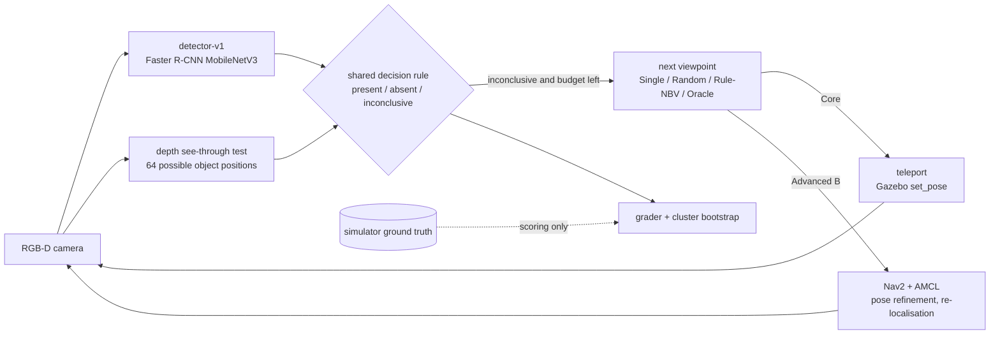
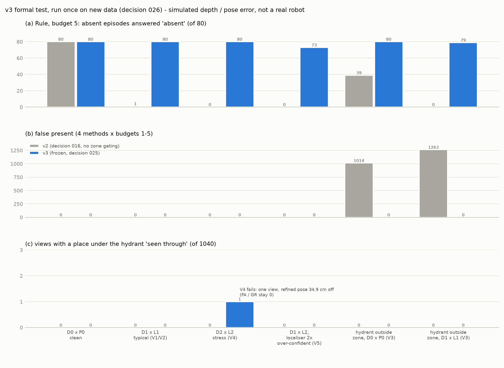
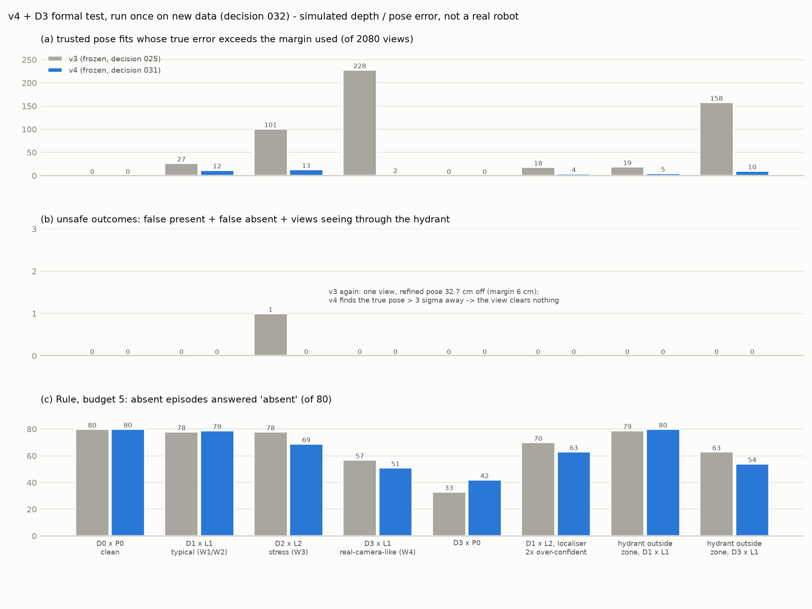
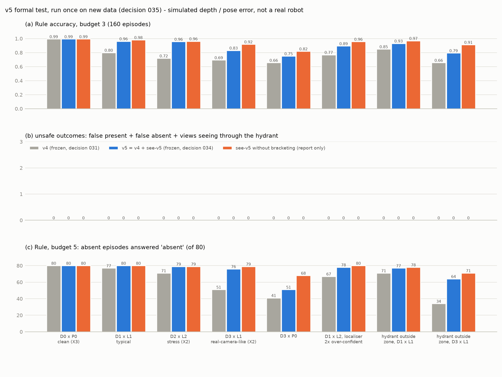

# Inspection Robot + Active Perception

[](https://github.com/jingwenliu0113-afk/inspection-robot-active-perception/actions/workflows/ci.yml)
[](LICENSE)


**English** | [繁體中文](README.zh-TW.md)

**When an inspection robot does not see its target, is the target absent, or just hidden?**
This project studies whether actively choosing the next viewpoint, under a fixed budget of views, answers
`present` / `absent` / `inconclusive` more reliably than a single view or random moves, **without ever calling a
hidden object absent**.

## At a glance

- **Problem.** A fire hydrant may stand in an inspection zone, and pillars may hide it. From one view, "hidden" and
  "not there" look the same. A robot that reports "absent" for a hidden hydrant gives a false all-clear.
- **Approach.** A shared, conservative decision rule answers `absent` only when the depth image has *seen through*
  every place where the object could stand. A rule-based next-best-view (NBV) policy picks views that see through
  the most unexplained places. The same pipeline runs with teleported cameras (Core) and with a TurtleBot 4 that
  drives there with Nav2 (Advanced B).
- **Headline results** (pre-registered, each formal test set run once):
  - At budget 3, Rule-NBV reaches **0.996** accuracy, against **0.907** for Random and **0.202** for Single View.
    Rule's false-absent rate is **0**.
  - With real Nav2 driving, Rule beats Random by **+0.079 [0.044, 0.119]** at budget 2. There are **0** false
    absents and **0** collisions in **960** closed-loop runs.
  - Under simulated stereo-camera depth error and localisation error, the latest version (v5) stays safe in all
    8 conditions and still answers `absent` (absent@5 **0.950** under the realistic D3 depth error with typical
    localisation error).
- **What is and is not validated.**
  - **Simulation:** every pipeline result comes from ROS 2 Jazzy + Gazebo Harmonic.
  - **Real photos:** the *detector alone* was tested on real internet photos (Open Images). These are not robot
    camera images.
  - **Real depth data:** the *depth-error model* was checked against public RealSense D435 / D455 recordings.
  - **Real robot:** the full system has **not** run on physical hardware.


*Demo: one real Nav2 closed-loop episode on development data (`nav-b1`), the actual output of `./docker/demo.sh`.*
1. At the start the hydrant is hidden behind a pillar, so the answer is `inconclusive`.
2. Rule-NBV v2 picks the next view. The TurtleBot 4 drives there with Nav2, re-localises against the facility map
   with its depth camera, and captures.
3. The second view is still blocked. From the start, almost nothing of the zone was visible, so 11 candidates tied
   and the lowest id (#0) won. This is a
   [known limitation](docs/failure-analysis.md#4-為什麼-rule-nbv-v2-沒有顯著貢獻分數平手時按編號選開發資料) of rule-nbv-v2.
4. The third view sees the hydrant, so the answer is `present` (confidence 0.99).

The path and hydrant position on the left come from simulator ground truth and are used for drawing only.

## Key results

R0a and A use real photos. B uses real depth recordings. Everything else runs in Gazebo.

| Stage | Formal evaluation data (each run once) | Main result | Read together with |
|---|---|---|---|
| **Core v1** | `core` test, 524 episodes | Rule-NBV accuracy at budget 3: 0.996 (Random 0.907, Single 0.202); Rule false absent 0 | "Close to Oracle" did **not** replicate on the new holdout |
| **Core v2** | `holdout`, 600 episodes | False absent 0 for all four methods; Rule at budget 2: 0.683 → **0.957** | The gain comes mainly from the **absent decision rule**; the new policy adds +0.020 (not significant) |
| **Advanced B** (Nav2) | `nav-b2`, 160 episodes, 960 Nav2 closed-loop runs | Nav2 vs teleport accuracy within 0.006; Rule − Random +0.079 [0.044, 0.119]; false absent and collisions 0 | Needs pose refinement, a see-through margin and re-localisation at stops; with AMCL poses alone the safety guarantee breaks |
| **R0a** (real photos) | Open Images: 383 photos with hydrants + 600 hard negatives | Clear hydrants detected at ≥ 0.7: 97.9%; complete misses under natural occlusion / truncation: 0 / 379 | False present on hard negatives 9.2% (criterion ≤ 1% **not met**); internet photos, not a robot camera |
| **R0b** (simulated error) | `r0b`, 160 episodes × 18 depth / pose error settings | Pipeline with pose refinement: false absent 0 and geometric risk 0 in all 9 error settings | With noisy depth `absent` is almost never decidable (0–1 / 80 at budget 5) |
| **v3** (simulated error) | `v3` + `v3-dx` (look-alike hydrant outside the zone), 160 episodes each | Typical error D1×L1: all safety counts 0; absent@5 0.013 → **1.000**; false present from the outside look-alike 1,014 / 1,263 → **0** | Stress setting D2×L2: 1 / 1,040 views crossed the safety margin (criterion V4 **failed**; false absent still 0) |
| **A** (real photos) | 737 hard negatives + 134 hydrant photos never seen by any detector | Hard-negative fine-tuning: false present 8.4% → **4.7%** (fixed 43 / broke 16, p = 0.0006); recall not worse | ≤ 1% criterion T1 **not met**; complete misses on positives 4 → 10 / 134 |
| **v4 + D3** (simulated error) | `v4` + `v4-dx`, 160 episodes each; v3 and v4 paired | v4 safe under D1, D2×L2 and D3 error; views beyond their margin D2×L2 101 → **13**, D3×L1 228 → **2** | v4 decides `absent` less often (D3×L1 absent@5 0.713 → 0.637) |
| **v5** (simulated error) | `v5` + `v5-dx`, 160 episodes each; v4 and v5 paired | All 8 conditions safe; Rule at budget 3: D2×L2 0.719 → **0.956**, D3×L1 0.694 → **0.831** | D3×P0 absent@5 still 0.637; 7 absent episodes became `inconclusive` through a different view path (safe direction) |
| **B** (real depth) | Public RealSense D435 / D455 plane recordings | Random error within the D2 range (close to D1) | D435 underestimates range by up to 2.48% (the model only assumed overestimation); correlation length 2.6–3× the model |

Every number and gate verdict is listed under [Detailed results](#detailed-results). The decision logs in
[docs/decisions/](docs/decisions/) (001–037) record every design choice, criterion and statistical method. Logs
that record results (010, 013, 019, …) say that they were written after the result. A test,
[`tests/test_readme_claims.py`](tests/test_readme_claims.py), checks the README numbers against the committed result
files.

## How it works



- **One decision rule for every method.**
  - `present`: detector confidence ≥ 0.7 (from v3 on, only for boxes located inside the zone).
  - `absent`: all 64 places where the object could stand have been seen through by some view's depth, and every
    confidence < 0.02. The place where the object really stands can never be seen through, so a missed detection
    cannot turn into a false absent.
  - Everything else: `inconclusive`. The four methods differ only in which views they choose.
- **Render-then-replay (Core).** Each viewpoint is rendered once in Gazebo, and all methods replay the same
  observations, so the differences between methods come only from view choice. The ROS 2 inspector node gives the
  same decisions online as in replay (pilot: v1 192 / 192, v2 168 / 168).
- **Nav2 closed loop (Advanced B).** A TurtleBot 4 with a 1.1 m mast camera drives with Nav2 and AMCL. Decisions
  use only the estimated pose, onboard images, the detector and a facility map of walls and pillars that does
  **not** contain the target.
- **Pose safety (v3–v5).**
  - The see-through test is only as safe as the pose behind it. Each view's pose is refined against the map, and
    the test takes the worst case over a margin of nearby poses.
  - A refinement that contradicts the localiser makes the view clear nothing.
  - v5 tolerates missing depth pixels only when they are bracketed by seen-through evidence.
- Full architecture, information boundary and module map: [docs/architecture.md](docs/architecture.md).

## Engineering highlights

| What | Details | Where to look |
|---|---|---|
| Pre-registered evaluation | Criteria, statistics and stop conditions are written in a decision log before any formal run; every formal test set is used once and then sealed | [docs/decisions/](docs/decisions/), [docs/EXPERIMENT_RULES.md](docs/EXPERIMENT_RULES.md) |
| Sealed results | `SEALED.sha256` pins every committed result, frozen episode set and frozen config; formal runners refuse to re-run and accept sealed data only in `--reproduce` mode | `uv run python -m activeperception.seal verify` |
| Information boundary | Decisions read only deployable data; ground truth is used only for scoring, attribution and the Oracle upper bound; candidate views do not depend on the object | [`tests/test_leakage.py`](tests/test_leakage.py) |
| Reproducibility | Seeded scene generator (specs regenerate bit for bit), seeded error draws per (episode, view, level), bit-identical figures, sealed outcomes reproduced with `--reproduce` | [docs/reproduce.md](docs/reproduce.md) |
| Statistics | Scene-group cluster bootstrap 95% CIs; paired comparisons that report "only A correct / only B correct" | `activeperception/metrics.py` |
| Tests and CI | 300+ tests (synthetic world, analytic ray-casting, leakage, sealing, README numbers vs result files); GitHub Actions without Docker or GPU | [`.github/workflows/ci.yml`](.github/workflows/ci.yml) |
| Shared-machine hygiene | Resource preflight (lock, CPU, RAM, Apple GPU) before heavy work; a shared GPU lock for CUDA jobs; containers isolated by name and network namespace | `activeperception/preflight.py`, [MACHINE_POLICY.md](MACHINE_POLICY.md) |
| Demo tooling | The animation tool rebuilds every decision input from deployable data and fails if it differs from the run log | `tools/make_demo.py` |

## Quick start

No Docker or GPU is needed for the tests, the sealed-result check or the figures:

```bash
uv sync                                             # Python 3.12, numpy, pytest, ruff, matplotlib
uv run pytest                                       # 1 test is skipped without local renders (see below)
uv run python -m activeperception.seal verify       # sealed results and frozen configs are unchanged
uv run python tools/make_figures.py                 # redraws the figures from committed results
```

The Nav2 demo needs Docker Desktop, the Nav2 images and the detector weights (download command in
[docs/reproduce.md §B](docs/reproduce.md#b-demo一集真正的-nav2-閉迴路)):

```bash
./docker/build.sh && ./docker/build_nav.sh && ./docker/build_navdet.sh
./docker/demo.sh                                    # one Nav2 closed-loop episode + animation (about 1-1.5 min)
```

- [docs/reproduce.md](docs/reproduce.md) covers four levels, from checks without Docker to full re-runs of Core and
  Advanced B, with timings and bit-for-bit comparison against the sealed results.
- The one skipped test needs `renders/core`, which is not in git. Rendering the 220 validation episodes takes about
  5.5 minutes with Docker (reproduce guide §C), and the frames are pixel-identical to the originals.

> The detailed documents (decision logs, development notes, reproduce guide) are written in Traditional Chinese.
> This README and the result tables are the English entry point.

## Detailed results

All formal evaluations follow the same order: write the decision log (protocol, criteria, statistics), then run
once on data that took no part in development. `holdout` and `nav-b2` were generated after their protocols were
written. 95% CIs are scene-group cluster bootstraps (1000 resamples); Random is averaged over several run seeds.

### Core v1 (`core` test: 131 scene groups, 524 episodes; decision 010)

| Budget | Single View | Random NBV | **Rule-based NBV v1** | Oracle NBV (upper bound) |
|---|---|---|---|---|
| 1 | 0.202 [0.16, 0.25] | 0.202 | 0.202 | 0.202 |
| 2 | 0.202 | 0.620 [0.58, 0.66] | **0.706 [0.66, 0.75]** | 0.710 [0.67, 0.75] |
| 3 | 0.202 | 0.907 [0.89, 0.92] | **0.996 [0.99, 1.00]** | 1.000 |
| 5 | 0.202 | 0.998 [0.996, 1.000] | **1.000** | 1.000 |

| Paired difference (same episodes) | Budget 2 | Budget 3 |
|---|---|---|
| Rule − Random, accuracy | **+0.086 [0.072, 0.101]** | **+0.089 [0.069, 0.108]** |
| Rule − Random, inconclusive rate | −0.085 [−0.100, −0.071] | −0.088 [−0.107, −0.068] |
| Rule − Single, accuracy | +0.504 [0.49, 0.52] | +0.794 [0.75, 0.83] |
| Oracle − Rule, accuracy | +0.004 [0.000, 0.011] | +0.004 [0.000, 0.011] |


- **Single View never gives a wrong definite answer, but says "don't know" 80% of the time.** The shared rule never
  treats "not seen" as `absent`, so one view answers `inconclusive` on every unobservable and absent episode
  (false absent 0).
- **Moving the camera turns `inconclusive` into correct answers.** Rule-NBV builds an obstacle height map from the
  depth of visited views and predicts how much of the zone each candidate would see. At budget 3 it reaches 0.996
  (Random 0.907) with 2.09 views on average.
- **Close to the upper bound on this test set**: the Oracle (which reads simulator ground truth) is only 0.004
  higher. This did **not** replicate on the new holdout, where the gap is 0.028–0.032 (see v2 and decision 013;
  the original record is unchanged).
- False absent rate at budget 2 / 3 / 5: Rule 0 / 0 / 0, Random 0.0015 (one scene where two random views saw the
  zone but missed the hydrant behind a pillar). False present: 0 for every method.
- Of Rule's 156 misses at budgets 2 / 3, 152 are a structural limit of the v1 absent rule at budget 2 (the Oracle
  fails there too). The 4 true policy failures share one scene: a second pillar hidden behind the first, which the
  height map treated as empty space.


**Detector (`detector-v1`).**
- Selection was done on a separate `detsel` split comparing YOLOv8m, YOLO11m and torchvision Faster R-CNN
  MobileNetV3.
- All three reached presence AUROC 1.000 and AP50 0.995–0.996. The pre-registered tie-break was the license
  (BSD over AGPL), which selected **FRCNN-MobileNetV3**
  ([decision 005](docs/decisions/005-detector-selection-protocol.md)).
- The YOLO detections are kept in [`results/detector-selection/`](results/detector-selection/table.md). YOLO itself
  can no longer be re-run from this repository (see [License](#license)).
- On test frames, hydrants with ≥ 10k visible pixels are detected 99.8% of the time. In this simulated scene the
  bottleneck is the viewpoint, not the detector.

### Core v2: unobserved places are no longer called absent (`holdout`: 150 scene groups, 600 episodes; decisions 011–013)

- **Why.** v1's absent rule ("≥ 2 valid sectors") is a proxy. A hydrant standing exactly where no view looked could
  still be called absent (Random did this once on the v1 test).
- **How.**
  - v2 was designed and tuned on core train / val only; the original test stays sealed.
  - It was evaluated once on the new `holdout`, side by side with v1.
  - `rule-nbv-v2` prefers views that see through places not yet seen through. It keeps a known-obstacle /
    known-free / unknown map and trusts sight lines through unknown space only half as much (v1 assumed they were
    free).


| Holdout (600 episodes) | Budget 2 | Budget 3 | Budget 5 |
|---|---|---|---|
| v1 Rule | 0.683 [0.64, 0.73] | 0.968 [0.95, 0.99] | 1.000 |
| **v2 Rule** | **0.957 [0.93, 0.98]** | **0.998 [0.995, 1.000]** | 1.000 |
| v2 Rule − v1 Rule | **+0.273 [0.228, 0.317]** | **+0.030 [0.010, 0.052]** | 0 |
| v2 Random / Single | 0.868 / 0.392 | 0.975 / 0.392 | 0.998 / 0.392 |
| v2 Oracle | 1.000 | 1.000 | 1.000 |

- **Safety.** False absent is 0 for every method at every budget (v1 Random: 0.07%).
- **Calibration.** ECE of definite decisions drops from 0.21–0.38 to ≤ 0.008.
- **Where the gain comes from (ablation, budget 2).**
  - The decision rule adds +0.253 [0.215, 0.293].
  - The new policy over the v1 policy adds only +0.020 [−0.020, 0.058], which is **not significant**. The gain is
    **not** a better view-selection policy.
- **v1 replication.** On holdout, v1 Rule still beats Random (+0.075 / +0.070), but Oracle − Rule is
  0.028 / 0.032, so v1's "close to Oracle" did **not** replicate.
- **Gap to the upper bound.** At budget 2, the Oracle is 0.043 [0.020, 0.070] higher; at budget 3 the gap is 0.002.
- **Remaining failures.** All 27 are `inconclusive`; none is a wrong definite answer.

### Gate summary (decision 009 §4 criteria applied unchanged; decision 014)

| Gate | v1 @ original test | v1 @ holdout | v2 @ holdout |
|---|---|---|---|
| 1. Rule reliably beats Random / Single | pass | pass | pass |
| 2. No leakage | pass | pass | pass |
| 3. Reproducible remaining failures | pass (156) | pass (209) | pass (27, all `inconclusive`) |
| 4. Rule close to Oracle | yes (0.004) | **fail** (0.028 / 0.032) | **fail at budget 2** (0.043 [0.020, 0.070]); pass at budget 3 |

The failed gates stay reported:
- v1's "close to Oracle" did not replicate on holdout.
- v2 is not close to the Oracle at budget 2. Under the SPEC this does not satisfy the RL stop condition, but the
  owner decided not to pursue RL (Advanced C).
- rule-nbv-v2 is not significantly better than rule-nbv-v1.


- **About 90% of v1's budget-2 failures are structural.** The v1 rule needs two valid sectors, which two views
  cannot provide when the first view is blocked. v2 needs one view that sees through every place: structural
  failures 173 → 0.
- **Paired changes.**
  - Swapping only the decision rule fixes 152 episodes and breaks 0.
  - Swapping only the policy fixes 31 and breaks 19 (net +0.020, not significant).
- **Root cause, confirmed on development data.** When the first view is blocked, 75–81% of rule-nbv-v2's second
  choices are score ties, broken by candidate id.

### Advanced B: active perception with real navigation (decisions 015–019)

- **Setup.**
  - Teleporting is replaced by **Nav2 navigation**: a TurtleBot 4 with a 1.1 m mast camera (same intrinsics as
    Core), AMCL localisation and Nav2 planning and control.
  - The decision rule, policy and detector are Core's frozen v2. Ground-truth poses and labels are used for
    scoring only.
- **At each stop.** The pose is refined by aligning onboard depth with the facility map, AMCL is re-localised, and
  the see-through test is conservative about the remaining pose error.
- **Formal evaluation.** New `nav-b2` set (160 episodes: absent 80, unobservable 38, visible 42), pre-registered in
  decision 018 and run once, with a paired teleport control on the same episodes.


| `nav-b2` (160 episodes, 960 closed-loop runs) | Budget 2 | Budget 3 |
|---|---|---|
| Rule-NBV v2: teleport / Nav2 | 0.988 / **0.981** | 1.000 / **1.000** |
| Random (3 seeds): teleport / Nav2 | 0.908 / 0.902 | 0.981 / 0.983 |
| Single / Oracle (Nav2) | 0.525 / 1.000 | 0.525 / 1.000 |
| Nav2 − teleport (Rule) | −0.006 [−0.019, 0.000], non-inferior | 0.000 |
| Rule − Random (Nav2) | **+0.079 [0.044, 0.119]** | **+0.017 [0.004, 0.033]** |
| Rule − Single (Nav2) | +0.456 [0.306, 0.613] | +0.475 [0.325, 0.650] |

- **Q1 safety.** Under Nav2, false absent, false present and "object present but everything counted as seen
  through" are 0 for every method and budget.
- **Q2 navigation.** All four methods are non-inferior to teleport (lowest CI bound −0.019; pre-registered margin
  −0.05).
- **Q3 active perception.** Rule still beats Single and Random significantly under Nav2.
- **Q4 cost.** Rule drives 0.46 m [0.14, 0.80] and 2.6 s (simulated time) less than Random per episode.
- **Navigation.** 440 / 440 navigations reached the viewpoint accurately, with 0 collisions and 0 timeouts.
- **Getting there took two failed feasibility rounds** (B0, decision 016):
  - With AMCL poses alone, the see-through test counted 2 / 6 present-object episodes as fully seen through.
  - Pose refinement + a see-through margin fixed that but missed the 90% arrival-accuracy bar (86.1%).
  - Adding re-localisation at each stop passed everything (144 / 144).
- **Limits.** Gazebo only; near-ideal odometry; known start pose and facility map. The scene (walled area, fixed
  ring of views) differs from Core, so the numbers are not directly comparable.
- Details: [`results/nav-b2/`](results/nav-b2/README.md),
  [decision 019](docs/decisions/019-b2-result-and-advanced-b-closure.md).

### R0: towards the real world, without hardware (decisions 020–023)

The owner decided not to buy a robot yet. Three kinds of validation are kept strictly apart:

| Name | What | Status |
|---|---|---|
| **R0a real-image test** | Real internet photos + the frozen detector and thresholds | done (decision 021) |
| **R0b simulated-noise test** | Gazebo images + depth noise and localisation / calibration error modelled from sensor specs | done (decision 023) |
| Real-robot validation | Physical robot, real site | **not done** |


**R0a** used 983 Open Images V7 photos: 383 with hydrants and 600 human-verified hard negatives. Photos overlapping
COCO (the detector's training source) were excluded, and images were scaled to about 640×480 pixels like the
simulated camera.

| Criterion | Result | Verdict |
|---|---|---|
| A1 clear hydrants detected on the box at ≥ 0.7 | 238 / 243 = 97.9% [95.3, 99.1] | pass |
| A2 hard negatives called present | 55 / 600 = 9.2% [7.1, 11.7] (criterion ≤ 1%) | **fail** |
| A3 absent blocked on hard negatives (max confidence ≥ 0.02) | 47.8% | not usable (only `inconclusive`, safe) |

- Complete misses are rare: with natural occlusion, truncation or small targets, 0 / 379 stayed below 0.02.
- False positives come from look-alikes: red post boxes, valves and standpipes, bollards, toys.
- **The decision rule had a structural weak point.** It took the image-wide maximum confidence, wherever the box
  was. The simulated scenes had no distractors, so this never showed before. v3 fixes it for look-alikes outside
  the zone.


**R0b** froze its criteria and error models before generating data. The error models come from the OAK-D Pro and
RealSense D435 datasheets and from the AMCL error measured in `nav-b0`.

| Criterion | Result | Verdict |
|---|---|---|
| R1 pose-refinement pipeline, typical error (D1 × L1) | False absent 0, geometric risk 0, places under the hydrant seen through 0 / 1,040 | **pass** |
| R2 the same, doubled error (D2 × L2) | All 0 | **pass** |
| R3 estimated pose only | Geometric safety lost in all 8 error settings | reproduces the B0 finding |

- **The cost.** With any depth noise, `absent` became almost undecidable: 0–1 / 80 at budget 5, for the Oracle
  too.
- **Safety was partly luck.** After refinement on noisy depth, the pose error p95 is 9–14 cm, far beyond the
  assumed 1.5 cm margin. Missing pixels made "all 64 places seen through" almost impossible, which hid the problem.

### v3: reliability fixes (decisions 024–026, simulated error)

| Weak point (source) | v3 fix |
|---|---|
| Look-alikes outside the zone called present (R0a) | `decision-v3`: each box is located with depth; only boxes inside the zone can make `present`; boxes that cannot be located still block `absent` |
| Missing depth makes `absent` undecidable (R0b) | `see-through-v3`: looks at a neighbourhood; missing pixels neither see through nor block alone |
| Noisy depth biases the pose fit, margin too small (R0b) | `nav-pose-v3`: range weighting, 5 m cut-off and depth-scale search; a fit that moves more than 3σ of the localiser fails; a fit that contradicts the localiser makes the view clear nothing; margin 6 cm / 0.03 rad |



| Criterion (decision 025, pre-registered) | Result | Verdict |
|---|---|---|
| V1 safety under typical error D1×L1 | All 0 | **pass** |
| V2 `absent` decidable under D1×L1: Rule budget 5 ≥ 0.90 | 80 / 80 = 1.000 (v2: 0.013) | **pass** |
| V3 look-alike hydrant outside the zone: as V1 | All 0 (v2 false present 1,014 / 1,263) | **pass** |
| V4 stress D2×L2: as V1 | Places under the object seen through: 1 / 1,040 (false absent still 0) | **fail** |
| V5 localiser over-confident by 2×: as V1 | All 0 | pass |

- Rule under D1×L1 at budget 2 / 3 / 5: 0.487 / 0.500 / 0.506 → **0.787 / 0.956 / 1.000**
  (v3 − v2 at budget 3: +0.456 [0.425, 0.481]).
- **The V4 failure.** One view's refinement believed it had succeeded but was 34.9 cm off. The estimate already was
  21.5 cm off, and the fit converged further in the wrong direction while staying within 3σ.

### A: hard-negative fine-tuning of the detector (decisions 027 / 030, real photos)

Zone gating cannot remove look-alikes **inside** the zone. The protocol was frozen before training: same
architecture, new weights, three pre-registered settings, and the same ≤ 1% criterion as R0a.

| Criterion (decision 027, pre-registered) | detector-v1 | detector-v2 | Verdict |
|---|---|---|---|
| T1 false present on hard negatives ≤ 1% | 62 / 737 = 8.4% | **35 / 737 = 4.7%** [3.4%, 6.5%] | **fail** |
| T2 positives not worse (≥ −0.05) | boxed 46 / 62, image level 66 / 72 | 49 / 62 (+0.048), 64 / 72 (−0.028) | pass |
| T3 simulation `detv2-sim`: visible, absent false positives | 827 / 828, 0 | 827 / 828, 0 | pass |
| T4 full v3 pipeline with v2 (D0×P0, D1×L1) | — | All safety counts 0 | pass |

- Paired on hard negatives: fixed 43, broke 16 (exact sign test p = 0.0006).
- **The cost.** Positive photos with no response at all (< 0.02) rose from 4 → 10 / 134.
- `detector-v2` does **not** replace the frozen `detector-v1`.

### v4: pose safety, and the formal validation of D3 (decisions 029–032, simulated error)

On development data, v3 had 65 (D2×L2) and 144 (D3×L1) views whose refinement "succeeded" with a true error beyond
its margin. Analysis ([docs/v4-development.md](docs/v4-development.md)) found three causes, plus one more for D3:

| Cause | v4 fix |
|---|---|
| Under L2 the localiser gate (3σ = 18 cm) was wider than the ±15 cm search window, so it never fired; far-off starts converged to wrong minima | Search max(15 cm, 4σ): a correct fit then moves beyond 3σ and becomes a *conflict*, so the view clears nothing |
| Different scale + translation pairs explain the same depth almost equally well | Search each depth scale 0.96–1.04; the pose spread of near-optimal hypotheses is added to the margin |
| Noise grows with range, so the uncorrected cost prefers shrinking the point cloud | Scale Jacobian: residuals compared in measured units |
| Under D3, a hydrant outside the zone can be located inside it (depth 6.3% short) | Zone gating over a ±8% depth band |



| Criterion (decision 031, pre-registered) | Result | Verdict |
|---|---|---|
| W1 v4 safe under typical error D1×L1 | All 0 | **pass** |
| W2 D1×L1 absent@5 ≥ 0.90 | 79 / 80 = 0.988 | **pass** |
| W3 v4 safe under stress D2×L2 (the V4 condition) | All 0 (v3: 1 / 1,040 seen through) | **pass** |
| W4 v4 safe under D3×L1 | All 0 | **pass** |
| W5 views beyond the margin ≤ 0.25 × v3 | D2×L2 13 / 101, D3×L1 2 / 228 | pass |
| W6 outside look-alike, D3×P0, over-confident localiser | All 0 | pass |
| D1 frozen v3 safe under D3 (formal D3 validation) | All 0 | **pass** |

- **The V4-type failure reappeared on new data, and v4 caught it.**
  - v3 trusted a fit that was 32.7 cm off.
  - v4 found the true pose (0.8 cm), saw that it moved 18.5 cm (beyond 3σ), and refused to clear anything with
    that view.
- **The cost.** Larger margins (median 10 cm) make `absent` harder: D1×L1 Rule budget 3 −0.081 [−0.125, −0.044];
  D3×L1 absent@5 0.713 → 0.637.

### B: the depth-error model against real stereo cameras (decision 028)

The R0b / v3 safety claims rest on the D1 / D2 depth-error models written from datasheets. B checks them against
public real data: RealSense D435 / D455 imaging a plane at 13 laser-measured distances (Rustler et al. 2025,
CC BY 4.0).

| Parameter (1–3 m) | Result |
|---|---|
| Random error | Within D2, close to D1 for both cameras (2 m: 16.1 / 22.6 mm; D1 20 mm) |
| Scale bias | D435 **underestimates** range by up to 2.48%; the model only assumed overestimation |
| Correlation length | Real error is 2.6–3× smoother than the model |
| Fixed pattern | Significant for D435 at 1 m: part of the error is fixed to the camera |

These findings define D3, a more realistic error level used to validate v3, v4 and v5. Details:
[docs/depth-noise-check.md](docs/depth-noise-check.md).

### v5: missing depth no longer vetoes the see-through test (decisions 033–035, simulated error)

- **The original plan failed in development.** v5 was meant to self-calibrate the depth scale from earlier views
  ([docs/v5-development.md](docs/v5-development.md)). Calibration itself worked (within 0.5%), but narrowing the
  scale hypotheses made pose errors beyond the margin more frequent.
- **The real bottleneck was the see-through test.** It required **every** one of 27 nearby poses to have enough
  valid pixels. D3's missing pixels cost one pose 5% of its see-through; vetoed across 27 poses, the loss grew to
  18%.
- **see-v5.**
  - Each of the 27 poses is classified as seen through, blocked, missing or out of view.
  - Any blocked or out-of-view pose vetoes, and at least 14 poses must see through.
  - A missing pose does not veto only when seen-through poses bracket it on both sides. One-sided stereo shadows
    next to a nearer surface are not bracketed, so v4's caution stays there.



| Criterion (decision 034, pre-registered) | Result | Verdict |
|---|---|---|
| X1 v5 safe in all 8 conditions | All 0 (places under the object seen through 0 / 1,040) | **pass** |
| X2 Rule budget 3, v5 − v4, CI lower bound > 0 | D2×L2 +0.237 [0.175, 0.294]; D3×L1 +0.138 [0.081, 0.194] | **pass** |
| X3 identical to v4 when no depth is missing | D0×P0 identical, item by item | **pass** |
| X4 no condition significantly worse | All 24 CI upper bounds > 0 | pass |

- absent@5: D2×L2 0.887 → 0.988, D3×L1 0.637 → 0.950, D3×L1 with an outside look-alike 0.425 → 0.800.
- Only 7 episodes were right under v4 and not under v5. All are absent episodes that v5 called `inconclusive`
  because a different clearing state led rule-nbv-v2 to a different next view. None became a wrong answer.

### After v5: development studies, no new formal version (decisions 036–037)

These two studies use development data only. Neither changes v5 or any sealed result.

- **In-zone look-alikes, E0** (decision 036):
  - The methods and metrics for a multi-view "confirm before present" rule were checked on existing data, with
    detector-v1 and v2 under identical conditions.
  - Single-image rotations or crops were **not** used as multi-view evidence.
  - The real multi-view data collection (E1) is deferred ([docs/e0-report.md](docs/e0-report.md)).
- **D3×P0 diagnosis and hypothesis H-P** (decision 037):
  - **Diagnosis.** v5's remaining `absent` failures with an exact localiser are not unobservable places. The
    refined pose and the localiser disagree because D3 biases the fit, so Rule's chosen views clear nothing.
  - **H-P.** When depth cannot tell the two apart, trust the localiser instead.
  - **Development result.** absent@5 went from 0.767 → 0.967, and decision-level safety stayed 0.
  - **Why it was not adopted.** Out of sample, with an over-confident localiser, 3 accepted views were 10.1–12.9 cm
    off against a 10 cm margin. That failed the pre-registered per-view safety gate. Following the stop conditions
    written in advance, H-P was stopped and recorded as a hypothesis that failed its safety gate
    ([docs/hp-development.md](docs/hp-development.md)).

## Failure analysis

Full write-up: [docs/failure-analysis.md](docs/failure-analysis.md) (post-hoc, read-only; never fed back into frozen
parameters). Selected findings:

| Finding | Impact | Handling |
|---|---|---|
| Every Rule failure was `inconclusive`, never a wrong definite answer (v1, v2, Nav2) | Failures only in the safe direction | — |
| ~90% of v1's budget-2 failures were structural (the Oracle failed too) | Removed by the v2 decision rule | decision-v2 |
| rule-nbv-v2 breaks score ties by candidate id 75–81% of the time when the first view is blocked | The v2 policy adds nothing significant; visible in the demo | Tie handling tried in v3 development: no gain, not adopted |
| With AMCL poses alone, the see-through test can look "through" the object | Safety guarantee lost | Pose refinement + margin + re-localisation (decision 016) |
| Real look-alikes are called present (R0a: 9.2% of hard negatives) | Risk of a wrong `present` | Outside the zone: v3 zone gating (formal FP 0). Inside: fine-tuning 8.4% → 4.7%, still above 1% |
| A far-off estimate plus a fit converging the wrong way (v3, D2×L2) | 1 / 1,040 views crossed the margin (V4 failed) | v4: 4σ search turns it into a conflict (decision 032) |
| Real D435 underestimates range, with correlated and partly fixed error (B) | Not covered by the R0b / v3 error model | D3 model; v3 and v4 formally safe under D3 |
| `absent` undecidable under D3 because any missing pose vetoed (v5 development) | v4 D3×L1 absent@5 only 0.637 | see-v5: 0.950, all safe |
| D3×P0: the fit contradicts an exact localiser, wasting chosen views (decision 037) | v5 D3×P0 absent@5 0.637 | H-P failed its safety gate; moved to Future Work |

## Research discipline

- **Criteria before results.** 37 decision logs record every decision that affects a conclusion, and say whether
  they were written after seeing results. Tuning used train only; validation was only checked.
- **Formal sets run once, then sealed.** This covers `core` test, `holdout`, `nav-b2`, the R0a formal set, `r0b`,
  `v3` / `v3-dx`, detector-v2's test and `detv2-sim`, `v4` / `v4-dx`, and `v5` / `v5-dx`.
- **v2 was proposed after seeing the v1 test,** so all of v2's claims come from the new holdout.
- **Failed gates stay in the README and decision logs:**
  - v1's "close to Oracle" did not replicate;
  - v2 is not close to the Oracle at budget 2;
  - B0 failed twice;
  - V4, A2 and T1 failed;
  - H-P failed its per-view safety gate.
- **Stop conditions are written before results.** H-P improved `absent` substantially, but its safety proxy was not
  0, so it stopped as specified. No criterion was relaxed afterwards.
- **Ground truth never enters a decision.** Candidate views are independent of the object (leakage tests). Nav2
  decisions use only estimated poses, onboard images and a map without the target.

## Limitations

- **Scene and perception.**
  - Deliberately simple scenes: square pillars, fixed lighting, one target class.
  - The detector rarely errs in this world, so perception is easy.
- **Policy.** rule-nbv-v2 often ties when the first view is blocked. v2's gain is a decision-rule gain, not a
  better policy.
- **Data use.** v2 was proposed after the v1 test. holdout, the original test and all formal sets have been used;
  any new version needs new data.
- **Advanced B.** Gazebo only, near-ideal odometry, known start pose and map, a walled site. Re-localisation
  raises the median navigation time per goal from 13.4 s to 22.3 s.
- **v3–v5.**
  - Safety under D3 is a simulation result.
  - Some views still exceed their margin (v4 D2×L2: 13 views, up to 8.7 cm) without hitting the object; this is
    not a guarantee.
  - Only 2× localiser over-confidence was tested.
  - v5's bracketing safeguard was never exercised by the formal data.
- **Detector.**
  - Look-alikes *inside* the zone remain the largest perception risk (detector-v2: 4.7% false present on hard
    negatives).
  - The real-photo tests use internet photos, not a robot camera.
- **Hardware.** There are no physical-robot results. Real images are internet photos (R0a / A), depth and pose
  errors are modelled in simulation (R0b / v3–v5), and real depth data is limited to public plane recordings (B).

## Future work

The project is closed for now. None of these items is started; each would need a new protocol.

| Item | Status | What it needs |
|---|---|---|
| In-zone look-alikes (E1) | E0 done; real multi-view data deferred | Real photos of the same objects from several viewpoints; single-image transforms cannot replace them |
| Localisation uncertainty under D3×P0 | Diagnosed; H-P failed its safety gate | A way to tell whether the localiser's reported uncertainty can be trusted (e.g. AMCL covariance calibration on a real robot), not a threshold change |
| Stereo-shadow test | Not done | Scenes where the object lies entirely in a stereo shadow next to a nearer surface, to test whether v5's bracketing is necessary |
| Gain prediction of rule-nbv-v2 | Not done | It can pick views that add no clearing when the clearing state changes (v5 formal: 7 episodes) |
| Real-robot measurement | No hardware | Whether real depth and localisation errors fall within D3 / L1–L2 |

Path towards real inspection: [docs/roadmap-real-inspection.md](docs/roadmap-real-inspection.md).

## Repository layout

```
activeperception/          core package: episodes, sim (Gazebo client, render, replay, ray-cast), sensing,
                           decision rules, policies, harness, grader, metrics, detector, sealing
activeperception/nav/      Advanced B: scenes and maps, TurtleBot 4 mast camera, pose refinement and margins, drivers
activeperception/v3 … v5/  reliability versions: see-through, pose refinement, zone gating, frozen configs, formal runners
activeperception/v6/       H-P (failed its safety gate, off by default), kept as a record
ros_ws/src/inspection_ap_ros/   ROS 2 package (inspector node, launch)
docker/                    images (sim / ros / nav / navdet), rendering, Nav2 batches, demo.sh
tools/                     make_figures.py (README figures), make_demo.py (demo animation)
gazebo/models/             vendored Fuel model (fire hydrant, CC0)
data/episodes/             frozen episode specs and sets (with ground truth)
results/                   committed results of every evaluation (pinned in SEALED.sha256)
docs/                      architecture, decision logs 001–037, development notes, failure analysis, reproduce guide
tests/                     300+ tests, including README numbers against the result files
```

Research definition: [SPEC.md](SPEC.md). Experiment rules: [docs/EXPERIMENT_RULES.md](docs/EXPERIMENT_RULES.md).
Progress log: [NEXT.md](NEXT.md).

## License

- The original code in this repository that its authors have the right to license is released under the
  **BSD-3-Clause** license ([LICENSE](LICENSE)). The ROS 2 package `package.xml` and `pyproject.toml` declare the
  same license.
- Third-party content is **not** covered and keeps its own license:
  - the fire-hydrant model (CC0 1.0);
  - the Open Images / COCO annotation subsets (CC BY 4.0);
  - the RealSense depth statistics (CC BY 4.0);
  - photos, which are referenced by URL only.
  Sources and attribution: [THIRD_PARTY_NOTICES.md](THIRD_PARTY_NOTICES.md).
- **Reproduction limit of the YOLO comparison.**
  - The YOLOv8m / YOLO11m models compared during detector selection (decision 005) belong to Ultralytics
    (AGPL-3.0). To keep this repository BSD-3-Clause, the YOLO adapter and the `ultralytics` dependency were removed
    before publication; the repository never contained Ultralytics code or weights.
  - The formal pipeline is unaffected: `detector-v1` is torchvision's Faster R-CNN (BSD-3-Clause), and every formal
    result uses only it.
  - The recorded YOLO detections and the selection table remain in `results/detector-selection/` (sealed, unchanged).
    Re-running YOLO requires installing `ultralytics` yourself under AGPL-3.0 or its commercial license.
