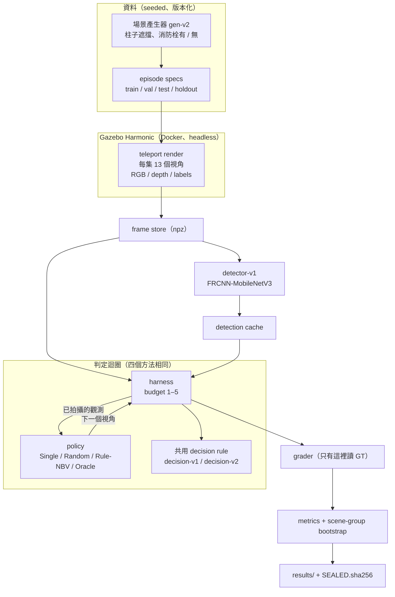
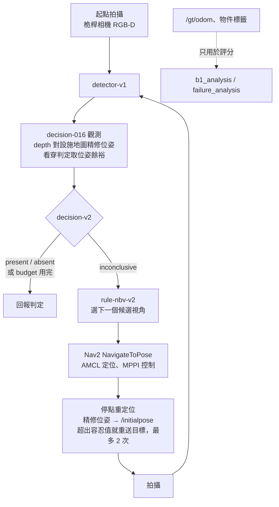

# 系統架構

本專案有兩條執行路徑，共用同一套判定程式碼：

- **Core（teleport）**：相機直接放到候選視角拍攝，排除導航的影響，只比較「選哪個視角」。
- **Advanced B（Nav2）**：TurtleBot 4 用 Nav2 實際開到視角。判定只能用機器人自己估計的位姿與機載感測器。

兩條路徑都**只在 Gazebo 模擬中執行**。實機的情況見 [README「驗證範圍」](../README.md#驗證範圍模擬已驗證--實機未驗證)。

## 1. 資訊邊界：判定能讀什麼、評分才能讀什麼

| 資料 | 判定（可部署） | Oracle（上限，不可部署） | 評分 / 分析 |
|---|---|---|---|
| RGB、depth（相機） | ✓ | ✓ | ✓ |
| detector-v1 輸出 | ✓ | ✓ | ✓ |
| 候選視角（只由 inspection zone 與場景 seed 決定） | ✓ | ✓ | ✓ |
| 設施地圖（牆、柱子；**不含目標物**） | ✓（只有 B） | ✓ | ✓ |
| AMCL 估計位姿 → depth 精修（只有 B） | ✓ | — | ✓ |
| 模擬器真實位姿 `/gt/odom` | ✗ | ✗ | ✓ |
| 物件是否存在、位置、每個視角的可見度標籤 | ✗ | ✓ | ✓ |

四個方法（Single、Random、Rule-NBV、Oracle）共用同一條判定規則，差別只在選了哪些視角。
程式上的保護包括：leakage tests（候選視角與物件無關）、`seal.py`（封存資料只能 `--reproduce`）、`tune.py`（拒絕 test / holdout）。

## 2. Core：render-then-replay

- 每個視角只 render 一次，四個方法 replay 同一份觀測，所以方法之間的差異只來自選視角（[decision 007](decisions/007-gazebo-observation-pipeline.md)）。
- ROS 2 線上版（`ros_ws/src/inspection_ap_ros` 的 inspector node）透過 `ros_gz_bridge` teleport，即時跑 detector 與 policy；
  pilot 上與 replay 的視角序列、判定 192 / 192 相同（v2：168 / 168）。

### 判定規則（`decision-v2`，四個方法共用）

- **present**：任一視角的消防栓 confidence ≥ 0.7。
- **absent**：inspection zone 內 64 個「物件可能站的位置」，每一個都在某個視角的 depth 中被**看穿**（視線沒被擋），而且所有 confidence < 0.02（decision 012 凍結值）。
  物件真正站的位置不可能被看穿（depth 先打到物件），所以 detector 漏看也不會變成 false absent。
- 其餘都是 **inconclusive**。

### 選視角（`rule-nbv-v2`）

用已拍攝的 depth 建出「已知障礙 / 已知空 / 未知」地圖，預測每個候選視角能看穿多少尚未看穿的位置；經過未知區域的視線只給一半信任。
已知限制：初始視角被完全擋住時，地圖幾乎全是未知，候選常常同分，由候選編號決定（[failure analysis §5](failure-analysis.md)；Demo 中可以看到）。

## 3. Advanced B：Nav2 閉迴路

| 元件 | 內容 |
|---|---|
| 機器人 | TurtleBot 4（`nav2_minimal_tb4_sim`），移除 OAK-D，加 1.1 m 桅桿相機（俯角 18°，內參同 Core 640×480、hfov 60°） |
| 定位 / 導航 | AMCL（TB4 雷射）＋ Nav2 1.3.13、MPPI；到點容忍 0.07 m / 0.05 rad |
| 地圖 | 由場景幾何產生：8 m 圍牆＋柱子＋zone 禁行區；**不含目標物**，present / absent 兩個變體共用同一張地圖 |
| `nav-pose-v1` | 把 depth 中 0.15–0.85 m 高的障礙點對齊牆內側面與柱子輪廓（2D、coarse-to-fine），退化時放棄 |
| `nav-margin-v1` | 對 27 個鄰近位姿取「最少看穿」的結果；精修失敗時改用較寬的餘裕 |
| `nav-relocalize-v1` | 到點後精修 → 發布 `/initialpose` → 仍超出容忍值就重送目標（最多 2 次） |
| 批次執行 | 每個（episode, 方法, seed）一個 `inspection-ap-navdet` 容器；動態工作佇列（`mkdir` 取號）、可續跑、Nav2 啟動看門狗 180 s |

設計來源：[decision 015](decisions/015-advanced-b-start-and-b0-protocol.md)（B0 協定）→ [016](decisions/016-b0-pose-refinement-and-margin.md)（B0 失敗後的修正）→
[017](decisions/017-b1-closed-loop-protocol.md)（閉迴路）→ [018](decisions/018-b2-formal-evaluation-protocol.md)（正式評估，預先登錄）→ [019](decisions/019-b2-result-and-advanced-b-closure.md)（結果）。

## 4. 程式模組

| 位置 | 角色 |
|---|---|
| `activeperception/episodes.py`、`types.py` | 場景與 episode 定義、split、GT 標記 |
| `activeperception/sim/` | Gazebo client、teleport render、replay world、解析 ray-cast（檢查 depth） |
| `activeperception/sensing.py` | depth → zone 可見度、障礙高度圖、64 個位置的看穿判定 |
| `activeperception/decision.py` | `decision-v1` / `decision-v2`（四個方法共用） |
| `activeperception/policies/` | Single、Random、Rule-NBV v1 / v2、Oracle v1 / v2 |
| `activeperception/harness.py`、`grader.py`、`metrics.py` | budget 迴圈、評分（唯一讀 GT 的地方）、指標與 bootstrap |
| `activeperception/detector/` | 三個候選 detector、選型評估、權重 sha256 驗證、偵測快取 |
| `activeperception/tune.py`、`experiment*.py`、`frozen*.py` | 預先登錄的調參、正式 runner、凍結設定 |
| `activeperception/seal.py`、`SEALED.sha256` | 封存已用過的正式資料與結果 |
| `activeperception/failure_analysis.py` | Core 失敗分析（只讀已 commit 的結果） |
| `activeperception/nav/` | Advanced B：場景 / 地圖、TB4 桅桿相機、位姿精修與餘裕、B0 / B1 driver、分析、失敗分析 |
| `ros_ws/src/inspection_ap_ros/` | ROS 2 inspector node（Core 線上版） |
| `docker/` | 映像（sim / ros / nav / navdet）、render、smoke、Nav2 批次、Demo |
| `tools/` | 圖表（`make_figures.py`）、Demo 動畫（`make_demo.py`） |

## 5. 執行環境

| 映像 | 內容 | 用途 |
|---|---|---|
| `inspection-ap-sim` | ROS 2 Jazzy + Gazebo Harmonic（arm64，headless ogre2 / llvmpipe） | teleport render |
| `inspection-ap-ros` | + `ros_gz_bridge` 與 inspector node | Core ROS 2 線上執行 |
| `inspection-ap-nav` | + Nav2 1.3.13、TurtleBot 4 模擬（apt 0 upgraded，不改動底層） | B0 |
| `inspection-ap-navdet` | + CPU torch / torchvision（detector 在容器內推論） | B1 / B2、Demo |

- 主要機器：Apple M4 Pro（48 GB）上的 Docker Desktop。detector 選型與 Core 的偵測在共享 GPU 機器上執行，遵守 `/tmp/ai-portfolio-gpu.lock`（[MACHINE_POLICY.md](../MACHINE_POLICY.md)）。
- 只使用 `inspection-ap-*` 名稱的映像與容器，不碰其他專案的容器、網路與 volume。
- 版本紀錄：[docs/platform/versions.md](platform/versions.md)、[versions-nav.md](platform/versions-nav.md)。
