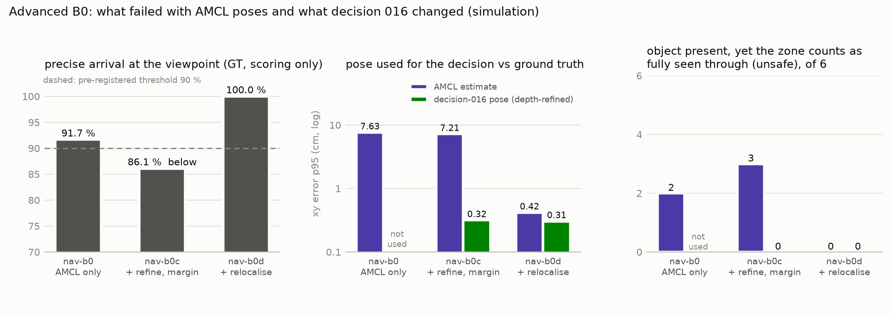
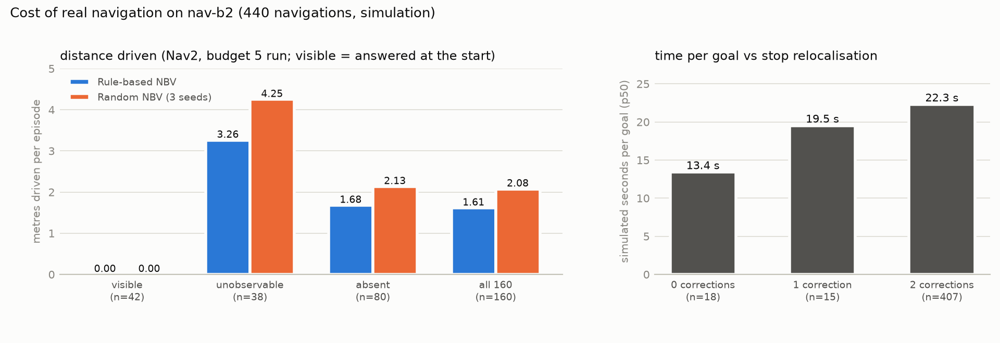

# Failure analysis

- **Part A — Core**（§1–7，decision 014 結案時寫成）：teleport 設定下 v1 / v2 的失敗。
- **Part B — Advanced B（Nav2）**（§8–12，作品集整理時補充）：B0 的兩次未通過、`nav-b2` 中 teleport 與 Nav2 不一致的每一件、重定位的代價、執行層面的失敗。
- **Part C — R0**（§14）：真實照片與模擬誤差下的失敗，細節在 decision 021 / 023。
- **Part D — v3 / B**（§15–16）：v3 開發與正式測試的失敗、depth 誤差模型沒有涵蓋的部分。
- **Part E — A / v4**（§17–19）：detector-v2 沒有達到 A2、V4 失敗的機制、v4 與 D3 正式測試。
- **Part F — v5**（§20）：比例自我校正的反效果、錯誤的瓶頸假設、正式測試中只有 v4 對的 7 集與仍未處理的限制。

各部分都是事後、唯讀的分析：不重跑正式評估，不改任何凍結值，結論不回饋到已封存的版本。

# Part A — Core（decision 014）

本文件 Part A **只讀已 commit 的正式結果**，沒有在 `core` test 或 `holdout` 上重跑任何方法，也**不回饋到任何凍結參數**（decision 014）。
四組資料**分開報告，不合併**：

| 名稱 | 來源 | 設定 | 用途 |
|---|---|---|---|
| `test/v1` | `results/test-v1/` | decision-v1 + rule-nbv-v1 + oracle-v1 | v1 正式 test（decision 010） |
| `holdout/v1` | `results/holdout/` | 同上（原封不動的 v1） | v1 結論的獨立重現（decision 013） |
| `holdout/v2` | `results/holdout/` | decision-v2 + rule-nbv-v2 + oracle-v2 | v2 正式評估（decision 013） |
| `holdout/ablation` | `results/holdout/` | decision-v2 + rule-nbv-v1（只有 Rule） | 區分改善來源 |

§4 的平手分析例外：它用**開發資料**（core train / val）重跑凍結的 v2 策略，程式拒絕 test 與 holdout。

重現：

```bash
uv run python -m activeperception.failure_analysis --out results/failure-analysis \
    --dev-episodes data/episodes/gazebo-core.json --dev-detections results/core/detector-v1.jsonl --dev-renders renders/core
```

完整數字：[`results/failure-analysis/summary.json`](../results/failure-analysis/summary.json)。

## 1. 錯誤型態：Rule 從不給出錯誤的肯定答案

| | Rule 錯誤的肯定答案 | false present（全部方法） | false absent |
|---|---|---|---|
| `test/v1` | 0 | 0 | Random 1 個 episode：`core-g0103-v0`（seeds 3、4，budget ≥ 2） |
| `holdout/v1` | 0 | 0 | Random 1 個 episode：`holdout-g0046-v2`（seed 3，budget ≥ 2） |
| `holdout/v2` | 0 | 0 | **無**（所有方法、所有 budget） |
| `holdout/ablation` | 0 | — | 無 |

兩個 false absent 都是 `unobservable`（物件存在、初始視角被擋）：Random 挑到兩個「zone 大致看得到、但消防栓剛好被擋」的視角，decision-v1 的扇區條件因此成立。
v1 在原 test 上出現的這種失敗在 holdout **同樣出現**；decision-v2 要求看穿每個候選位置，結構上排除了它。

**Rule 的每一個失敗都是 `inconclusive`**，沒有任何一個是錯誤的 `present` / `absent`。

## 2. Rule 失敗歸因：budget 限制，還是視角選擇？

把每個 Rule 失敗依「同一條判定規則、同一個 budget 下，Oracle 是否答對」分成兩類：

- **結構性（Oracle 也失敗）**：在這個 budget 與這條判定規則下，12 個候選中怎麼選都答不出來（budget 2 只有一次選擇，因此這是窮舉的結論）。
- **視角選擇（Oracle 答對）**：同樣的候選，更好的選擇就能答對——這是 Gate 4「Rule 與 Oracle 差距」的組成。


| 資料 | budget 2：失敗 = 結構性 + 視角選擇 | budget 3：失敗 = 結構性 + 視角選擇 |
|---|---|---|
| `test/v1`（524） | 154 = 152 + 2 | 2 = 0 + 2 |
| `holdout/v1`（600） | 190 = 173 + 17 | 19 = 0 + 19 |
| `holdout/ablation`（600） | 38 = 0 + 38 | 4 = 0 + 4 |
| `holdout/v2`（600） | **26 = 0 + 26** | **1 = 0 + 1** |

- v1 在 budget 2 的失敗約 90% 是結構性的，而且全部是 `absent`：decision-v1 需要 2 個有效扇區，初始視角被擋時 budget 2 只剩一個視角，Oracle 也湊不到。
- decision-v2 只要求「每個候選位置都被某個視角看穿」，一個好的視角就夠 → **結構性失敗全部消失**。這就是 v2 改善的主要來源（§3）。
- 換成 decision-v2 之後，剩下的失敗**全部可歸因於視角選擇**（Oracle-v2 每一件都答對）——這正是 v2 在 budget 2 的 Gate 4 未通過（Oracle − Rule = 0.043）。

## 3. 改善來源：成對轉移（holdout，同一批 600 episodes）

| 轉移 | 只改了什麼 | budget 2：修好 / 弄壞 | budget 3：修好 / 弄壞 |
|---|---|---|---|
| v1 Rule → 消融 | **判定規則**（decision-v1 → v2） | **152 / 0** | 15 / 0 |
| 消融 → v2 Rule | **視角策略**（rule-nbv-v1 → v2） | 31 / 19 | 4 / 1 |
| v1 Rule → v2 Rule | 兩者 | 171 / 7 | 19 / 1 |

- **判定規則的改變是單調的**：沒有任何一個 v1 答對的 episode 因此變錯。
- **策略的改變有得有失**：budget 2 修好 31 件、弄壞 19 件，淨 +12（+0.020 [−0.020, 0.058]，不顯著）。
- 結論（decision 014 的正式說法）：**v2 的改善主要來自 absent 判定規則，不是 NBV 策略。**

### v2 相對 v1 的退步（v1 答對、v2 沒答對）

- budget 2 共 7 件，全部是 `unobservable → inconclusive`：`holdout-g0019-v2`、`g0058-v0`、`g0088-v2`、`g0105-v2`、`g0113-v0`、`g0113-v2`、`g0133-v0`。
  v1 策略（以及消融）在第二個視角就看到消防栓；rule-nbv-v2 選了另一個視角，只看到一部分或完全看不到（兩件有 0.35–0.40 的弱偵測，低於 τ_present 0.7）。
- budget 3 共 1 件：`holdout-g0058-v1`（`absent → inconclusive`，三個視角後看穿 84%）。
- 沒有任何一件退步成錯誤的肯定答案。

## 4. 為什麼 rule-nbv-v2 沒有顯著貢獻：分數平手時按編號選（開發資料）

在 core train / val（開發資料）上，對凍結的 v2 在 budget 2 的「第二個視角」決策點計算每個候選的分數：

| split | 初始視角 zone 被擋（可見 < 0.3） | 決策點 | 最高分有平手 | 平均平手候選數（共 12） |
|---|---|---|---|---|
| train | 是 | 285 | **230（81%）** | 8.0 |
| train | 否 | 10 | 2 | 1.2 |
| val | 是 | 96 | **72（75%）** | 7.6 |
| val | 否 | 11 | 5 | 1.5 |

機制：

1. 初始視角被柱子擋住時，已知地圖幾乎沒有「已知空」的格子。
2. 對每個沒被已知障礙擋住的候選，所有未看穿位置的視線都會經過未知格子，因此 `clear_gain` 都等於 `p_unknown`（0.5）→ **平手**。
3. 凍結的 `w_novelty`、`w_attraction`、`w_visibility` 都是 0（decision 012 的平手規則偏好「非零權重最少」），沒有其他特徵打破平手，
   `sorted(scored)[0]` 因此選**編號最小**的候選。
4. 候選編號從每個 scene group 的隨機相位開始，所以實際行為接近「排除已知被擋的候選後，按固定順序挑一個」——比 Random 好（會避開已知障礙），但沒有利用更多資訊。

holdout 的描述性觀察與此一致：v2 在 budget 2 的 26 個失敗，第二個視角**全部**是候選 0 或 1（`report.json` 的 `viewpoint_sequence`）。

**這是凍結 v2 的已知限制，本 Core 不修正。** 修正（例如平手時改用 novelty、或對未知空間用更有資訊的先驗）屬於 v3：
需要新的 decision log，並在**新的、未參與開發的資料**上驗證；原 test 與 holdout 都不能再用（decision 014）。

## 5. 失敗與場景特徵

**初始視角是否看得到 zone** 是最強的分界：四組資料中，初始視角 zone 可見 ≥ 0.3 的 episodes **沒有任何 Rule 失敗**；所有失敗都發生在初始視角被擋的 episodes。

柱子數量（budget 2，Rule 失敗率）：

| 柱子數 | `test/v1` | `holdout/v1` | `holdout/v2` |
|---|---|---|---|
| 1 | 27.0%（53 / 196） | 30.4%（51 / 168） | 2.4%（4 / 168） |
| 2 | 32.1%（54 / 168） | 30.0%（60 / 200） | 1.5%（3 / 200） |
| 3 | 29.4%（47 / 160） | 34.1%（79 / 232） | **8.2%（19 / 232）** |

v1 的失敗率幾乎不隨柱子數變化（被結構性失敗主導）；v2 的殘餘失敗集中在 3 根柱子的場景（19 / 26）——柱子越多，平手時的固定順序越容易挑到只能部分看穿的視角。

## 6. v1 結論在 holdout 的重現

| v1 結論（decision 010，原 test） | holdout | 判定 |
|---|---|---|
| Rule 穩定勝過 Random / Single | rule − random +0.075 / +0.070（CI 下界 > 0） | **重現** |
| Rule 接近 Oracle（差 0.004） | 差 0.028 [0.012, 0.048] / 0.032 [0.012, 0.055] | **未重現** |
| Random 偶發 false absent | 同樣 1 個 episode | 重現 |
| 殘餘失敗以 budget 結構限制為主 | budget 2：173 / 190 是結構性 | 重現 |

holdout 上 v1 的 budget 3 差距來自 19 件視角選擇失敗（17 absent、2 unobservable）；原 test 只有 2 件。decision 010 原文不改，原 test 的 0.004 視為偏樂觀的單次估計。

## 7. 本分析不做的事

- 不改任何凍結參數、判準、split 或 metric；不在 test / holdout 上重跑任何方法。
- §4 的平手現象只記錄為限制，不據此調整 v2。
- 任何由本分析得到的改進想法，都必須先寫 decision log，並在新的 namespace 產生的新資料上驗證。

# Part B — Advanced B（Nav2）

作品集整理時補充（decision 019 之後），同樣是**事後、唯讀**：讀已 commit 的 B0 報告（`results/nav-b0*/b0_report.json`）與 `nav-b2` 的原始執行紀錄（`runs/nav-b2`，也就是 `b1_analysis` 評分用的同一批檔案）。
沒有重跑任何正式評估，沒有修改任何凍結值；`nav-b2` 已用過，本分析只解釋已報告的數字。

```bash
uv run python -m activeperception.nav.failure_analysis --out results/nav-failure-analysis
```

完整數字：[`results/nav-failure-analysis/summary.json`](../results/nav-failure-analysis/summary.json)。
執行需要本機的 `runs/nav-b2`（約 285 MB，不進 repo）與 `renders/nav-b2`；沒有這些檔案時，直接讀已 commit 的 `summary.json`。

## 8. B0 的兩次未通過與修正



| | `nav-b0`（只用 AMCL） | `nav-b0c`（+ 位姿精修、看穿餘裕） | `nav-b0d`（+ 停點重定位） |
|---|---|---|---|
| 準確到點（預先登錄 ≥ 90%） | 91.7% | **86.1%（未過）** | 100% |
| 判定用位姿的誤差 p95 | AMCL 7.6 cm / 0.039 rad | 精修 0.32 cm / 0.0005 rad（AMCL 7.2 cm / 0.037 rad） | 精修 0.31 cm；重定位後 AMCL 0.42 cm / 0.0021 rad |
| 物件存在，所有停點聯集卻被算成全部看穿 | **2 / 6（未過）** | AMCL 位姿 3 / 6 → 判定用位姿 0 / 6 | 0 / 6 |
| 錯誤答案 / geometric risk（168 組判定） | 0 / 1 | 0 / 0 | 0 / 0 |
| 每個目標的導航時間 p50（模擬） | 12.6 s | 12.9 s | 18.9 s |

**`nav-b0`：安全邊界失效（C6）。** `decision-v2` 把一個位置算成「看穿」的條件是：實測 depth ≥ 該點在影像中的預期深度 − 3 cm。
AMCL 的位置誤差有數公分、朝向誤差約 0.02–0.04 rad，用錯的位姿投影時，視線可能「穿過」物件真正站的位置。
2 / 6 個物件存在的 episode 在所有停點聯集後被算成全部看穿；這次答對只是因為 detector 看到了物件（present 優先）。
也就是說，v2「漏看不會判 absent」的保證**依賴位姿精度**，這是 decision 016 的起點。

**`nav-b0c`：安全修好了，到點率未過（C3）。** 以機載 depth 對設施地圖精修位姿（p95 0.32 cm），看穿判定再對剩餘誤差取最保守值 → 聯集風險 0 / 6。
但 Nav2 用 AMCL 判斷是否到點：到點當下約 0.05 rad 的朝向誤差，加上 0.05 rad 的容忍值，20 次未準確到點中有 18 次是真實朝向差 0.100–0.116 rad（另 1 次位置差 0.10 m、1 次 Nav2 回報失敗）。
這不是判定錯誤，但未達預先登錄的門檻 → 停下，由使用者決定再試一次。

**`nav-b0d`：停點重定位後全部通過。** 代價有兩項：
- 餘裕讓「初始 + 一個停點」組合的 absent → absent 從 54 / 84 降到 47 / 84（7 組變成 `inconclusive`，安全方向）。
- 每個目標的導航時間 p50 從約 12.6–12.9 s 增加到 18.9 s。這兩個數字來自不同的 episodes，只能作為粗略比較。

## 9. `nav-b2`：teleport 與 Nav2 不一致的每一件（正式 budget 2、3）

同一批 160 集、四個方法（Random 3 seeds），正式 budget 下 teleport 與 Nav2 的對錯不同的只有 5 件。**沒有任何一件變成錯誤的肯定答案。**

| 方法 | budget | episode（GT） | teleport → Nav2 | 原因（兩者選了相同的視角） |
|---|---|---|---|---|
| Rule | 2 | `nav-b2-g0009-v1`（absent） | absent → inconclusive | 看穿 63 / 64（Nav2，含餘裕）vs 64 / 64（teleport） |
| Random s1 | 2 | `nav-b2-g0009-v1`（absent） | absent → inconclusive | 同上 |
| Random s0 | 2 | `nav-b2-g0026-v2`（unobservable） | present → inconclusive | 消防栓只露出約 22%：confidence 0.71（teleport）vs 0.48（Nav2） |
| Random s1 | 2 | `nav-b2-g0024-v0`（unobservable） | present → inconclusive | 只露出約 25%：0.76 vs 0.39 |
| Random s2 | 3 | `nav-b2-g0034-v1`（absent） | inconclusive → **absent（Nav2 才答對）** | Nav2 停點看穿 64 / 64，teleport 63 / 64 |

兩種機制：

1. **看穿餘裕**（安全方向）：decision 016 對剩餘位姿誤差取最保守值，偶爾少算一個位置 → 需要多一個視角。budget 3 時 `g0009-v1` 兩個方法都答對。
   反方向也會發生：實際停點與理想視角差幾公分，有時反而看到更多（`g0034-v1`）。
2. **接近門檻的偵測**：消防栓只露出約四分之一時，teleport 的 confidence 剛好超過 0.7。Nav2 停點偏離目標 3–4 cm、約 0.05 rad，confidence 就掉到 0.4–0.5。
   判定規則把它留在 `inconclusive`，沒有出錯，但這顯示**部分可見時，偵測對公分級的視角變化很敏感**。
   實機有動態模糊、光照與相機校正誤差，這個敏感度只會更重要，需要另外量測（見 [後續建議](roadmap-real-inspection.md)）。

## 10. 位姿精修退化時的備援

`nav-pose-v1` 在影像中能對齊的牆面 / 柱子輪廓不足時（退化檢查未過），會放棄精修，判定改用較寬的餘裕（0.10 m / 0.06 rad）。

| 拍攝時機 | 精修失敗 | 分布 |
|---|---|---|
| 起點（960 次） | 72 | 全部集中在 3 / 40 個 scene groups（`g0013`、`g0021`、`g0032`）：這些場景的起點視角在每一次執行都退化 |
| 停點（440 次） | 5 | `g0013` 3 次、`g0029`、`g0031` 各 1 次 |

這 12 集在正式 budget 下，四個方法的 Nav2 結果都與 teleport 相同（不在 §9 的清單中），也沒有任何錯誤答案。
decision 019 報告的「精修失敗 5 / 440」只計算停點；起點的 72 次是本次補充的。

## 11. 停點重定位的代價



| | 結果 |
|---|---|
| 修正次數 0 / 1 / 2（上限 2） | 18 / 15 / **407**（92.5% 用滿） |
| 最後一次精修位姿相對目標的誤差 | p50 3.0 cm / 0.046 rad；p95 5.9 cm / 0.049 rad |
| 最後落在容忍值（0.07 m / 0.05 rad）內 | 419 / 435（另外 5 次精修失敗） |
| 每個目標的導航時間 p50（模擬） | 0 次修正 13.4 s；1 次 19.5 s；2 次 22.3 s |
| 真實到點（評分用，≤ 0.10 m / 0.10 rad） | 440 / 440 |

- **朝向是瓶頸**：最終朝向誤差的中位數 0.046 rad，緊貼 0.05 rad 的容忍值。
- 推測原因（未驗證）：Nav2 只要 AMCL 認為朝向在 0.05 rad 內就停下，精修位姿與 AMCL 差幾個 0.01 rad，於是又被判定超出容忍值、重送目標。
- 結果是**正確但慢**：多數目標要多花約 9 秒（模擬時間）。
- 可能的改進（例如讓 Nav2 的容忍值與精修判準一致、或直接用精修位姿判斷是否到點）屬於新版本：需要新的 decision log 與新資料。本專案不修改。

## 12. 執行層面的失敗（基礎設施）

| 事件 | 處理 | 對結果的影響 |
|---|---|---|
| `nav-b0` 第一次批次被 Docker Desktop 更新（29.8.1 → 29.8.2）中斷 | 保存舊 attempts log，整批重跑 | 無（中斷的批次不使用） |
| `nav-b1` 一次 Gazebo 啟動崩潰，`BasicNavigator` 卡住約 28 分鐘 | 每個工作使用獨立的 world 目錄；加入 Nav2 啟動看門狗（180 s 未就緒就退出重試） | 無 |
| `nav-b0d` 第一次啟動時 `specs_by_id` 漏了新 namespace | 每集都在 `prepare` 失敗、沒有產生資料；修正後重跑 | 無 |
| 靜態分配工作，最後只剩一個 worker 在跑 | 改成動態佇列（`mkdir` 原子取號） | 只影響時間 |
| `nav-b2`：980 次嘗試，20 次被看門狗終止（exit 3） | 18 個工作重試；其中 2 個第一輪兩次都失敗，續跑時成功；0 缺漏 | 無（失敗的工作沒有 `run.json`，從頭重跑） |

`nav-b2` 的 960 次閉迴路在 Apple M4 Pro 上以 4 個容器並行，約 2 小時 17 分鐘（attempts log 17:51–20:08 UTC）。

## 13. Part B 不做的事

- 不重跑 `nav-b2`，不依本分析調整任何參數或判準。
- 不把 Nav2 的數字與 Core 合併或直接比較（場景不同，見 decision 019）。
- §9–11 提到的改進想法（餘裕、偵測門檻附近的敏感度、到點容忍值）都只是記錄。若要實作，必須以新版本、新資料驗證。

# Part C — R0 真實環境適應研究（decision 020–023）

## 14. R0 找到的失敗

| 來源 | 失敗 | 機制 | 安全影響 |
|---|---|---|---|
| R0a（真實照片） | 偏難負樣本 9.2% 被判成 present（A2 未通過） | 郵筒、閥門、立管、路樁、玩具等外觀相近物體；判定取整張影像最高信心，不檢查是否在 zone 內 | **錯誤的肯定答案**（false present） |
| R0a | 偏難負樣本 47.8% 的最高信心 ≥ 0.02 | 同上，較弱的反應 | 無（absent 被擋下 → `inconclusive`） |
| R0a | 人工遮住 75% 時 17.3% 完全漏看 | 只剩一小條可見 | 無，前提是 depth 看穿判定正確（→ R0b） |
| R0b（模擬誤差） | 管線 (a) 在所有有誤差的組合失去幾何保證 | 位姿或 depth 誤差讓視線「穿過」物件位置 | 有風險；這次靠 detector 看到物件才沒出錯 |
| R0b | 管線 (b) 精修後位姿誤差 p95 9–14 cm | depth 比例偏差與成片隨機誤差拉偏 2D 對齊；退化檢查偵測不到 | 目前被下一列掩蓋 |
| R0b | 管線 (b) 幾乎不判 absent（budget 5 下 0–1 / 80） | 缺值像素 × 27 個位姿的餘裕 | 無（安全但沒用） |

R0 的分析都依預先登錄的判準判定；事後的機制診斷只用開發資料（`r0b-dev`）或已執行的正式輸出，屬描述性，不回饋到任何凍結值。


# Part D — v3 可靠性改善與 B depth 模型檢查（decision 024–028）

## 15. v3 開發與正式測試找到的失敗

開發（`v3-dev`）的失敗都在開發時修正並記錄（[docs/v3-development.md](v3-development.md) §4.1、§4.4）。
正式測試（decision 026）只跑一次，失敗照實保留。

| 來源 | 失敗 | 機制 | 處理 |
|---|---|---|---|
| 開發 | see-through-v3 單獨使用：5 / 780 個視角，消防栓底下的位置被看穿 | 雜訊 depth 讓 v2 精修偏移 7–19 cm，卻自認成功，只給 1.5 cm 餘裕 | nav-pose-v3 + 較大餘裕 |
| 開發 | nav-pose-v3 錯誤收斂 20.8 cm（自認成功） | 對齊到錯的牆面，殘差仍小 | 定位器先驗閘門（偏移 > 3σ 判失敗） |
| 開發 | 精修失敗時誤差 16.6 cm > 寬餘裕 10 cm | L2 的誤差比 decision 016 的寬餘裕大 | 寬餘裕 max(10 cm, 3σ) |
| 開發 | 定位器過度自信 2 倍時，先驗閘門擋掉**正確**的精修（修正 14 cm） | 定位器回報的 σ 太小 | 精修與定位器矛盾時，視角不提供看穿（正式 V5 通過） |
| 開發 | v2（decision 016）本身在 D2×P0 有 1 / 780 | +2% 比例誤差讓 v2 精修偏移 | v3 的比例搜尋（R0b 正式資料上同條件為 0 / 1,040，R0b 結論不變） |
| **正式（V4）** | D2×L2：1 / 1,040 個視角越過安全餘量 | 估計位姿已偏離 21.5 cm，精修又往錯的方向移動，仍在 3σ 內（最終 34.9 cm） | **未修正**。候選方向：殘差分布檢查、視角之間的位姿一致性；需新版本與新資料 |
| 開發（負面結果） | 平手處理沒有改善 | gen-nav-v1 場景中 v2 已接近上限 | 不採用 |
| 開發（負面結果） | 左右半邊精修的差異不能當不確定性 | 相關 0.04–0.22，差異主要來自兩邊看到的牆面不同 | 不採用 |

v3 正式測試中，物件存在時沒有任何一集被判成 absent（FA = 0，所有條件、方法、budget）。V4 的失敗是逐視角安全餘量的突破，不是錯誤的答案。

## 16. B：誤差模型沒有涵蓋的部分

真實 D435 / D455 平面資料（[docs/depth-noise-check.md](depth-noise-check.md)）顯示 R0b 模型的盲點：

- 偏差方向：D435 低估距離，最多 2.48%。模型只假設高估。
- 相關長度：長 2.6–3 倍。
- 固定樣式：D435 在 1 m 處顯著。
- 每張影像的整體浮動：約 1%。

這些不改變已報告的 R0b / v3 結論；它們定義了下一個要驗證的誤差等級 D3。

# Part E — A detector-v2 與 v4 開發（decision 029–030）

## 17. A：困難負樣本微調沒有達到 A2

| 失敗 | 機制 | 處理 |
|---|---|---|
| T1 未通過：偏難負樣本誤報 4.7%（≤ 1% 的判準） | 誤報顯著下降（修好 43、弄壞 16），但人工確認的負樣本中仍有大量外觀接近的物體；dev 上 5.3% 已經預示 | 照實記錄；`detector-v2` 不取代 v1。可能方向（新版本）：更多困難負樣本、多種子、信心重新校準 |
| 正樣本完全漏看 4 → 10 / 134 | 微調讓信心分佈更「乾脆」：誤報少了，但沒把握的正樣本被壓到 0.02 以下 | 記錄；在巡檢管線中還需要幾何把消防栓位置看穿才會變成 false absent（模擬中為 0），實機前要追蹤 |

## 18. V4 失敗的機制（v4 開發，`v3-dev`）

decision 026 的 V4 失敗（1 / 1,040）只是更普遍問題的一角。開發代理指標「精修自認成功、但真實誤差超出餘裕的視角」：

| 條件 | v3 | 其中起點在搜尋範圍外 |
|---|---|---|
| D1×L1 | 21 / 978 | 0 |
| D2×L2 | 65 / 937 | 4 |
| D3×L1 | 144 / 854 | 0 |

- 正式測試那一個視角屬於「起點在範圍外」：L2 的 3σ 閘門（18 cm）比 ±15 cm 搜尋範圍寬，閘門從未作用。
- 其餘大多數來自**比例與平移互相補償**：同一張 depth 可以用不同的「比例 + 平移」組合解釋得幾乎一樣好（成本差 3–10%，位姿差 7–14 cm），v3 只取一組。
- 還有一個估計偏差：depth 雜訊與距離成正比，未修正的成本偏好把點雲縮小（比例偏向上緣）。
- 修正方向與開發結果：[docs/v4-development.md](v4-development.md)。

## 19. v4 與 D3 正式測試（decision 032）找到的失敗

| 來源 | 失敗 | 機制 | 處理 |
|---|---|---|---|
| 正式，**凍結的 v3** | D2×L2：1 / 1,040 個視角，消防栓底下的位置被看穿（與 V4 相同類型） | 估計位姿偏 21.8 cm、真正位姿在搜尋範圍外，精修往錯的方向收斂（32.7 cm） | v4 在同一視角找到真正的位姿，移動 18.5 cm > 3σ → 矛盾、不提供看穿 |
| 正式，v4（未造成不安全結果） | 精修自認成功但誤差超出餘裕：D2×L2 13、D3×L1 2、`v4-dx` D3×L1 10、D1×L1 12 個視角 | 假設之間的離散度沒有涵蓋全部的擬合誤差；最多超出 8.7 cm（D2×L2） | 記錄；方向沒有對準消防栓所以安全，但不是保證 |
| 正式，v4 的代價 | absent 較難判：D1×L1 budget 3 −0.081、D3×L1 absent@5 0.713 → 0.637 | 餘裕 = 6 cm + 假設離散度（中位 10 cm） | 取捨，照實報告 |
| 開發，v3 與 v4 前身 | D3 下 zone 外消防栓被判 present（1 集） | 偵測框 depth 短 6.3%，定位點從 0.91 m 移到 0.74 m，進入 zone 判定範圍 | v4 的 ±8% depth 區間過濾；正式資料上 v3 沒有發生 |

# Part F — v5 看穿判定修正（decision 033–035）

## 20. v5 開發與正式測試找到的失敗與限制

- **比例自我校正的反效果**（開發）：只縮窄比例假設帶時，超出餘裕的視角變多。多出來的大多是比例已擬合在真值附近、位置卻錯 7–14 cm 的錯誤收斂；
  v4 的寬假設帶恰好給出很不同的位姿、把離散度撐大而擋下它們。**v4 有一部分保護是意外的多起點一致性檢查**（[docs/v5-development.md](v5-development.md) §2）。
- **錯誤的假設**（開發）：一開始認為 D3 的 absent 判不出是因為 depth 短 2.5%。真實位姿下改用校正 depth，看穿的位置完全不變；
  瓶頸其實是「27 個位姿中任何一個缺值就否決」（§3）。
- **只有 v4 對的 7 集**（正式，事後分析）：全部是 absent 集被 v5 判成 inconclusive，原因是清除狀態不同導致 rule-nbv-v2 選了不同的視角（decision 035 §3）。
- **仍未處理**：D3×P0 有 683 / 2,080 個視角因精修與幾乎精確的定位器矛盾而不提供看穿，absent@5 只有 0.637。
- **包住規則的必要性未被檢驗到**：不包住的版本在 320 集正式資料上也安全；它防範的幾何（物件整個落在貼著近處表面的立體遮蔽帶）沒有出現。
