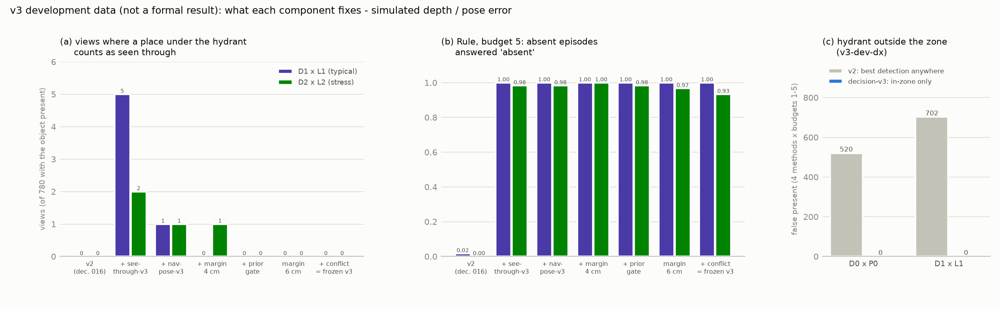

# v3 可靠性改善：開發紀錄（decision 024）

**這裡的數字全部來自開發資料**（`v3-dev`、`v3-dev-dx`、真實照片開發組），用來選擇元件與決定是否值得做正式測試，**不是正式結果**。
正式測試的規格與判準見 decision 025，結果見 decision 026（若已執行）。

三種驗證不得混用：

- 真實照片：Open Images 影像，影像層級；
- 模擬誤差：Gazebo 渲染加上 `r0b_noise.py` 的 depth / 位姿誤差；
- 實機：**沒有做**。

所有開發列的完整數字：[`results/v3-dev/ablation.json`](../results/v3-dev/ablation.json)，以 `python -m activeperception.v3.report` 產生。

## 1. R0a 的誤報：真實照片開發組（影像層級）

資料：R0a 沒用到的 Open Images 影像，以固定 seed 分半。

- 開發組 807 張：736 張人工確認不含消防栓、71 張含消防栓但沒有框。
- 另一半（809 張）保留，未執行 detector。
- 分析：`python -m activeperception.v3.realimg analyze`，輸出在 `runs/v3-realimg/analysis.json`（不 commit；影像不在 repo）。

### 1.1 門檻與信心

| present 門檻 | 含消防栓：判 present | 不含：false present |
|---|---|---|
| 0.5 | 66 / 71 = 93.0% | 101 / 736 = 13.7% |
| **0.7（凍結值）** | 64 / 71 = 90.1% | 67 / 736 = 9.1% |
| 0.9 | 58 / 71 = 81.7% | 31 / 736 = 4.2% |
| 0.95 | 55 / 71 = 77.5% | 18 / 736 = 2.4% |
| 0.98 | 44 / 71 = 62.0% | 3 / 736 = 0.4% |
| 0.99 | 34 / 71 = 47.9% | 1 / 736 = 0.1% |

- 開發組重現了 R0a 正式集的 A2 結果（9.1% vs 9.2%）。
- 要把影像層級的 false present 壓到 1% 以下，present 門檻得拉到約 0.98，代價是約 4 成真消防栓判不出。
- 偵測框形狀（高寬比、面積）的過濾，在 recall 只少 5 個百分點以內時，最好只能把 9.1% 降到 7.7%。
  誤報框的形狀與真消防栓重疊：高寬比中位數 1.89 vs 1.91。
- 結論：**單靠影像資訊（門檻、信心、框形狀）無法解決**，而且凍結門檻不得更動。
  v3 改從「偵測在哪裡」下手（§3 zone 過濾）。

信心校準：`detector-v1` 的信心在模擬中校準良好（Core ECE ≤ 0.008）。
但在真實照片上，0.9 以上的高信心誤報仍有 31 張，代表信心值反映的是「長得像消防栓」，不是「inspection zone 內有消防栓」。
v3 不重新校準信心（那需要改 detector 或門檻），而是用幾何資訊限定哪些偵測算數。

### 1.2 困難負樣本：誤報的類型

開發組 67 張 false present（信心 ≥ 0.7）逐張目視分類。這是**單人判讀，不是正式標註**。
清單見 [`results/v3-dev/hard-negatives-dev.csv`](../results/v3-dev/hard-negatives-dev.csv)，影像 ID 可對照 Open Images。

| 類型 | 張數 | 例子 | 在巡檢現場的意義 | zone 過濾能處理嗎 |
|---|---|---|---|---|
| 雕像 / 玩偶 / 雪人 / 裝飾品 | 21 | 雪人、樂高人偶、木雕、石燈籠 | 工業現場少見 | 在 zone 外可以；在 zone 內不行 |
| 柱狀街道設施 | 17 | 郵筒、垃圾桶、路樁、交通錐筒、水桶 | **現場常見** | 在 zone 外可以；在 zone 內不行 |
| 遠處小目標（框 < 約 1% 畫面） | 13 | 路邊遠處的小物體，部分人眼也無法確認是否其實是消防栓 | 可能是標註遺漏 | 通常在 zone 外，可以 |
| 管件 / 抽水機 / 閥門 / 立管 | 9 | 手壓抽水機、鑄鐵立管、逆止閥管組、工業插座 | **現場最危險的混淆** | 在 zone 外可以；在 zone 內不行 |
| 其他 | 7 | 蠟燭罐、餵鳥器、機車、汽水瓶 | — | 視位置 |

- 重點：**和消防栓同樣出現在設施裡的管件、閥門與柱狀設施**（26 張）。
  如果它們就在 inspection zone 內，zone 過濾無法處理，只能靠 detector 本身（困難負樣本微調）或額外的外觀檢查。
  依 decision 024，v3 不改 detector，所以這一類列為**已知限制**。
- 至少 1 張（rank 9）看起來就是消防栓，可能是標註錯誤；遠處小目標也有幾張類似。
  所以 9.1% 是誤報率的上限估計，不是精確值。

## 2. 遮擋：「看不到」不是「不存在」

判 absent 的唯一途徑，是 zone 內 64 個可能位置**全部**被 depth「看穿」，而且沒有 zone 內的偵測擋下。
看不到的位置（被柱子擋住、depth 缺值、位姿不確定）永遠不算看穿，所以「看不到」只會讓結果變成 `inconclusive`，不會變成 `absent`。
v3 改變的是「怎樣才算看穿」：容忍缺值、以位姿不確定度擴大檢查範圍。但它從不把「看不到」當成「看到了」。

Rule 的判定，依 GT 狀態分（`v3-dev`，120 集；present / absent / inconclusive）：

| 條件 | 管線 | budget | visible（31） | unobservable（29，初始被擋） | absent（60） |
|---|---|---|---|---|---|
| D0×P0 | v2 | 2 | 31 / 0 / 0 | 29 / 0 / 0 | 0 / 58 / 2 |
| D0×P0 | v2 | 5 | 31 / 0 / 0 | 29 / 0 / 0 | 0 / 60 / 0 |
| D1×L2 | v2 | 2 | 31 / 0 / 0 | 26 / 0 / 3 | 0 / **0** / 60 |
| D1×L2 | v2 | 5 | 31 / 0 / 0 | 29 / 0 / 0 | 0 / **1** / 59 |
| D1×L1 | v3 | 2 | 31 / 0 / 0 | 27 / 0 / 2 | 0 / 35 / 25 |
| D1×L1 | v3 | 5 | 31 / 0 / 0 | 29 / 0 / 0 | 0 / 60 / 0 |
| D2×L2 | v3 | 2 | 31 / 0 / 0 | 26 / 0 / 3 | 0 / 22 / 38 |
| D2×L2 | v3 | 5 | 31 / 0 / 0 | 29 / 0 / 0 | 0 / 58 / 2 |

- **物件存在時，沒有任何一集被判成 absent**：所有條件、所有方法、所有 budget 的 false absent 都是 0。
  初始被擋的 unobservable 集數，budget 小時是 `inconclusive`（2–3 集），移動到其他視角後全部變成 present。
- **detector 漏看也不會變成 absent**：geometric risk 是「物件存在、但所選視角把 64 個位置都看穿」。
  它與 detector 無關，各條件都是 0。物件本體所在的位置從來沒有被所有視角一起看穿；全視角版本也是 0。
- **代價在 absent 那一邊**：depth 有雜訊時，v2 幾乎所有 absent 集都只能回答 `inconclusive`（誠實，但沒有用）。
  v3 在 budget 5 讓 58–60 / 60 集重新判得出 absent；budget 2 時仍有 25–38 集需要更多視角。
- 「看不到」與「不存在」的區分，在定位器過度自信時仍需要額外的處理（§4.4）。

## 3. zone 過濾（decision-v3）：v3-dev-dx 干擾物場景

`v3-dev-dx`：30 個場景 × 4 個變體，每個場景在 zone 外放一支消防栓，模擬 R0a 發現的「zone 外相似物件」。
干擾物離 zone 中心 0.95–1.45 m（近，在 zone 與視角環之間）或 2.45–3.3 m（遠，在對面視角的背景裡），
Gazebo 語意標籤 50，不算目標。開發資料，從來不是正式集。

先用 v2 幾何單獨看 zone 過濾的效果（四個方法 × budget 1–5 合計）：

| 條件 | zone 過濾 | FP | FA | Rule b2 / b3 / b5 | absent@5 |
|---|---|---|---|---|---|
| D0×P0 | 無（v2） | **520** | 0 | 0.725 / 0.767 / 0.767 | 0.533 |
| D0×P0 | 有 | **0** | 0 | 0.933 / 1.000 / 1.000 | 1.000 |
| D1×L1 | 無（v2） | **702** | 0 | 0.483 / 0.500 / 0.517 | 0.033 |
| D1×L1 | 有 | **0** | 0 | 0.483 / 0.500 / 0.525 | 0.050 |

- v2 取整張影像的最高信心：zone 外的消防栓讓 absent 被判成 present（R0a A2 的弱點在模擬中重現）。
- zone 過濾後，D0×P0 與 D1×L1 的 false present 都是 0，present 的正確率不變（visible / unobservable 在 budget 3 都是 1.000）。
- 偵測定位：
  - 物件存在的集數：1,024 個偵測，692 個判 zone 內、332 個判 zone 外（干擾物）。
  - 物件不存在的集數：414 個偵測，410 個判 zone 外，4 個判 zone 內。這 4 個的信心都 ≤ 0.002，低於 `tau_absent` 0.02，連 absent 都不會擋下。
  - 沒有「無法定位」的偵測。
- D1×L1 下 absent 仍判不出：那是 v2 幾何的問題（§4），與 zone 過濾無關。完整 v3 的結果見 §6。
- **限制**：zone 過濾只處理 zone **外**的相似物件；zone 內的管件、閥門、柱狀設施（§1.2）不在範圍內。

## 4. depth 品質、定位誤差補償與不確定性（nav-pose-v3 / see-through-v3）

R0b 的兩個問題：

1. depth 有缺值時，v2 的看穿判定一個缺值像素就擋下整個位置，absent 判不出。
2. 雜訊 depth 讓 decision 016 的位姿精修偏移（p95 9–14 cm），但精修仍自認成功，只給 1.5 cm 餘裕。

消融（`v3-dev`，120 集；FA / FP / GR / 全視角 GR 在下表所有列都是 0）：

| 條件 | 設定 | 佔用位置看穿 | Rule b2 / b3 / b5 | absent@5 | 位姿誤差 p95 / max | 精修成功 |
|---|---|---|---|---|---|---|
| D1×L1 | v2（decision 016） | 0 / 780 | 0.475 / 0.500 / 0.508 | 0.017 | 10.0 / 20.1 cm | 0.93 |
| D1×L1 | + see-through-v3 | **5** / 780 | 0.800 / 0.950 / 1.000 | 1.000 | 10.3 / 20.8 cm | 0.84 |
| D1×L1 | + nav-pose-v3（加權、5 m、比例） | **1** / 780 | 0.783 / 0.967 / 1.000 | 1.000 | 6.8 / 21.5 cm | 0.66 |
| D1×L1 | + 餘裕 4 cm / 0.02 rad（m4） | 0 / 780 | 0.758 / 0.950 / 1.000 | 1.000 | 6.8 / 21.5 cm | 0.66 |
| D1×L1 | + 先驗閘門 k = 3（m4p） | 0 / 780 | 0.767 / 0.950 / 1.000 | 1.000 | 6.7 / 11.6 cm | 0.63 |
| D1×L1 | 餘裕 6 cm / 0.03 rad（**m6p**） | 0 / 780 | 0.775 / 0.958 / 1.000 | 1.000 | 6.7 / 11.6 cm | 0.63 |
| D2×L2 | v2 | 0 / 780 | 0.475 / 0.500 / 0.500 | 0.000 | 15.0 / 27.8 cm | 0.76 |
| D2×L2 | + see-through-v3 | **2** / 780 | 0.750 / 0.933 / 0.992 | 0.983 | 14.8 / 25.4 cm | 0.67 |
| D2×L2 | m4 | **1** / 780 | 0.733 / 0.908 / 1.000 | 1.000 | 13.9 / 23.5 cm | 0.60 |
| D2×L2 | m4p | 0 / 780 | 0.683 / 0.867 / 0.992 | 0.983 | 13.9 / 23.5 cm | 0.60 |
| D2×L2 | **m6p** | 0 / 780 | 0.658 / 0.817 / 0.983 | 0.967 | 13.9 / 23.5 cm | 0.60 |
| D0×P0 | v2 | 0 / 780 | 0.983 / 1.000 / 1.000 | 1.000 | 0.0 / 0.1 cm | 0.98 |
| D0×P0 | m4p / m6p | 0 / 780 | 0.975 / 1.000 / 1.000 | 1.000 | 0.0 / 0.1 cm | 0.62 |
| D0×L2 | v2 | 0 / 780 | 0.983 / 1.000 / 1.000 | 1.000 | 6.8 / 23.5 cm | 0.93 |
| D0×L2 | m4p / m6p | 0 / 780 | 0.950 / 1.000 / 1.000 | 1.000 | 13.3 / 23.5 cm | 0.62 |
| D2×P0 | v2 | **1** / 780 | 0.483 / 0.500 / 0.500 | 0.000 | 11.4 / 20.8 cm | 0.85 |
| D2×P0 | m4p / m6p | 0 / 780 | 0.708 / 0.850 / 0.983（m4p） | 0.967 | 2.2 / 3.9 cm | 0.35 |

位姿誤差是判定實際使用的位姿：精修成功時是精修結果，失敗時是估計位姿（再配寬餘裕）。

開發資料上的新發現：**v2（decision 016）本身在 D2×P0 也有 1 個佔用位置被看穿的視角**——只有 depth 雜訊、沒有位姿誤差。
R0b 正式資料（`r0b`）上同一條件是 0 / 1,040，R0b 的結論不變；但這表示 v2 的安全餘量很小，換一批場景就可能出現。
（R0b 的正式判準 R1 / R2 只針對 D1×L1、D2×L2；佔用看穿是報告項目。）

### 4.1 失敗案例：每個「佔用位置被看穿」的視角

| 設定 | 條件 | 視角數 | 精修自認成功？ | 實際位置誤差 | 使用的餘裕 | 原因 → 修正 |
|---|---|---|---|---|---|---|
| see-through-v3 + v2 精修 | D1×L1 | 5 | 是 | 7–19 cm | 1.5 cm | 雜訊 depth 讓 v2 精修偏移，卻自認成功 → nav-pose-v3 + 較大餘裕 |
| nav-pose-v3（m4 之前） | D1×L1 | 1 | 是 | 20.8 cm | 1.5 cm | 錯誤收斂：對齊到錯的牆面，殘差仍小 → 定位器先驗閘門 |
| m4 / m8 / pose | D2×L2 | 1 | 否 | 16.6 cm | 10 cm（固定寬餘裕） | 精修失敗時的寬餘裕小於 L2 的誤差 → 寬餘裕改為 max(10 cm, 3σ) |
| **v2（decision 016）** | D2×P0 | 1 | — | 位姿誤差 p95 11.4 cm（沒有加位姿誤差） | 1.5 cm | +2% depth 比例誤差讓 v2 精修偏移 → v3 的比例搜尋與餘裕（v3 在此條件為 0） |

- 精修自認成功、但誤差 > 10 cm 的視角數（D1×L1）：v2 76、nav-pose-v3 12、加先驗閘門 1。
- **仍存在的風險**：D2×L2 下先驗閘門的門檻是 3 × 6 = 18 cm，所以精修自認成功、誤差 10–18 cm 的視角仍有 20 個（937 個成功視角中）。
  它們在開發資料上沒有造成佔用位置看穿：消防栓本體比網格點距大，誤差要剛好落在特定方向才會看穿。
  這是幾何上的寬裕，**不是保證**。正式測試的 V4（D2×L2）會檢查這一點。
- 先驗閘門假設定位器誠實回報自己的不確定度。正式測試的 V5 檢查定位器過度自信 2 倍的情況。

### 4.2 沒有用的嘗試

- **左右半邊各自精修的差異當作不確定性**：與實際誤差的相關只有 0.04–0.22。兩半邊看到的牆面不同，差異主要來自幾何，不是誤差 → 關閉。
- **放寬退化檢查**（最小特徵值 10 → 5，`-e5`）：精修成功率 0.66 → 0.70，但成功視角中的大誤差變多（> 10 cm：12 → 15）→ 不採用。
- **餘裕 8 cm（m8）**：安全性與 m4 相同（D2×L2 的 1 個視角是精修失敗的情況，與成功時的餘裕無關），只增加代價 → 不採用。

### 4.3 代價

- v3 的精修成功率只有約 0.6（v2 約 0.93）。5 m 截斷讓遠處牆面不參與擬合，最小特徵值變小，常被判為退化。
  失敗時改用寬餘裕，仍然安全，但需要更多視角才能判 absent（D1×L1 Rule b2 0.775，乾淨時 0.975）。
- D2×P0 的成功率 0.35：+2% 的比例誤差讓擬合殘差變大。

## 5. 平手處理（rule-nbv-v3）

v2 的已知限制：被擋住時第二視角的決策 75–81% 是平手，按候選編號選（decision 014 failure analysis）。
加入極小的 novelty 權重（1e-3，只用來打破平手）：

| 條件 | 平手處理 | Rule b2 / b3 / b5 | 平均視角數（b3） |
|---|---|---|---|
| `v3-dev` D0×P0（v2 幾何） | 無 | 0.983 / 1.000 / 1.000 | 1.52 |
| `v3-dev` D0×P0（v2 幾何） | 有 | 0.975 / 1.000 / 1.000 | 1.53 |

- 沒有改善（budget 2 差 1 集，budget 3 相同）。在 `gen-nav-v1` 場景中 v2 已接近上限。
- **v3 不採用**，維持凍結的 `rule-nbv-v2`。這是負面結果，保留紀錄。

### 4.4 定位器過度自信：先驗閘門的反效果與修正

先驗閘門假設定位器誠實回報不確定度。開發資料上的壓力測試：實際誤差是 L2（σ 6 cm），定位器卻回報 L1（σ 3 cm），過度自信 2 倍。

- m6p 在這個條件下有 **1 / 780** 個佔用位置被看穿。
  那個視角的精修其實是對的（修正 14 cm），但超過回報的 3σ（9 cm），被當成錯誤收斂擋掉。
  於是改用寬餘裕 10 cm，而實際誤差是 17.6 cm。
- 修正原則：擬合條件良好、卻與定位器互相矛盾時，**兩者都不信任**：該視角不判任何位置為看穿，偵測照常計入。

| 條件 | 設定 | 佔用看穿 | Rule b2 / b3 / b5 | absent@5 | 矛盾視角 / 1,560 |
|---|---|---|---|---|---|
| D0×P0 | m6p / **m6c** | 0 / 0 | 0.975 / 1.000 / 1.000（兩者相同） | 1.000 | 0 |
| D1×L1 | m6p / **m6c** | 0 / 0 | 0.775 / 0.958 / 1.000（兩者相同） | 1.000 | 53 |
| D2×L2 | m6p | 0 | 0.658 / 0.817 / 0.983 | 0.967 | — |
| D2×L2 | **m6c** | 0 | 0.650 / 0.808 / 0.967 | 0.933 | 81 |
| D1×L2，回報 L1 | m6p | **1** | 0.792 / 0.975 / 1.000 | 1.000 | — |
| D1×L2，回報 L1 | **m6c** | 0 | 0.733 / 0.892 / 0.958 | 0.917 | 407 |
| D1×L1 | m6b（精修失敗也不可信） | 0 | 0.617 / 0.725 / 0.825 | 0.650 | 53（+ 529 退化） |

- m6c 在四個條件下都安全。定位器誠實時，代價與 m6p 幾乎相同。
- m6b 太保守：D1×L1 的 absent@5 只剩 0.65。
- **仍存在的風險**：定位器過度自信、精修又退化時，寬餘裕 max(10 cm, 3 × 回報的 σ) 可能小於實際誤差。
  開發資料上沒有發生，但沒有保證。正式測試的 V5 會檢查。

## 6. 選定的 v3 與正式測試

選定（decision 025 凍結，`activeperception/v3/frozen_v3.py`）：

| 元件 | 選擇 |
|---|---|
| zone 過濾 | 開（`decision-v3`） |
| 看穿判定 | `see-through-v3` |
| 位姿精修 | `nav-pose-v3`（加權、5 m 截斷、比例搜尋），定位器先驗閘門 k = 3 |
| 餘裕 | 成功 6 cm / 0.03 rad；退化時 max(10 cm / 0.06 rad, 3σ)；矛盾時視角不可信（m6c） |
| Rule-NBV | 凍結的 `rule-nbv-v2`（平手處理不採用） |
| detector、門檻 | 不變（`detector-v1`、0.7 / 0.02） |

開發資料上的完整組合（`runs/v3-dev/conflict`、`confirm-dx`）：

| 資料 | 條件 | FA | FP | GR | 佔用看穿 | Rule b2 / b3 / b5 | absent@5 |
|---|---|---|---|---|---|---|---|
| `v3-dev` | D0×P0 | 0 | 0 | 0 | 0 | 0.975 / 1.000 / 1.000 | 1.000 |
| `v3-dev` | D1×L1 | 0 | 0 | 0 | 0 | 0.775 / 0.958 / 1.000 | 1.000 |
| `v3-dev` | D2×L2 | 0 | 0 | 0 | 0 | 0.650 / 0.808 / 0.967 | 0.933 |
| `v3-dev` | D1×L2，回報 L1 | 0 | 0 | 0 | 0 | 0.733 / 0.892 / 0.958 | 0.917 |
| `v3-dev-dx` | D0×P0 | 0 | 0 | 0 | 0 | 0.900 / 0.983 / 1.000 | 1.000 |
| `v3-dev-dx` | D1×L1 | 0 | 0 | 0 | 0 | 0.725 / 0.908 / 0.992 | 0.983 |

`v3-dev-dx` 那兩列是 m6p 加 zone 過濾（在 `v3-dev` 的 D0×P0 與 D1×L1，m6c 與 m6p 的結果完全相同）。

正式測試：新資料 `v3`、`v3-dx`，協定與判準見 decision 025，結果見 decision 026。
