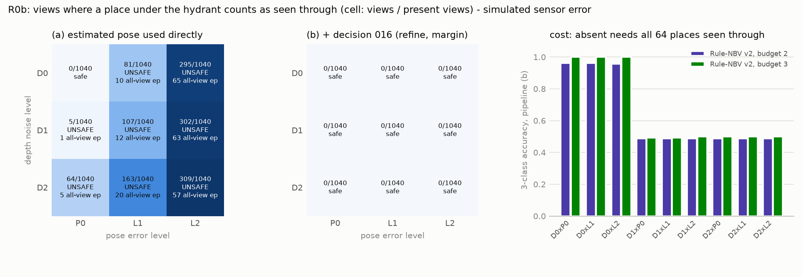

# R0b：depth 雜訊與定位誤差下的 v2 安全性（decision 022 / 023）

**這是模擬雜訊測試**：Gazebo 影像加上依感測器規格建模的誤差，不是真實感測器，也不是實機驗證。協定與判準在產生資料之前凍結（decision 022），結果見 [decision 023](../../docs/decisions/023-r0b-result.md)。

- 資料：`r0b`，160 集（`gen-nav-v1`：圍牆、方柱、2.0 m 視角環、1.1 m 桅桿相機），teleport render，detector 用乾淨 RGB。
- 誤差（`activeperception/r0b_noise.py`）：
  - depth：D1 典型（2 m 處隨機 1%、∝ z²，比例偏差 +1%，邊緣缺值 / flying pixel，1% 缺值）、D2 規格上限（2%、+2%、3%）。
  - 位姿：L1 典型（x / y 3 cm、yaw 0.02 rad、高度 1 cm、pitch 0.005 rad）、L2 加倍。
- 兩條管線：(a) 直接用估計位姿；(b) decision 016（以雜訊 depth 對設施地圖精修位姿 + 看穿餘裕），與 Advanced B 相同。



## 一句話

- **管線 (b) 在全部 9 種誤差組合都沒有 false absent（R1、R2 通過）**；沒有 decision 016 的管線 (a) 只要有誤差就失去安全保證。
- **但代價很大**：只要 depth 有雜訊，(b) 就幾乎不再判 absent（budget 5 時 absent 正確率 0–1%，Oracle 也一樣）。
- **安全的來源**：在雜訊 depth 上精修後的位姿誤差 p95 有 9–14 cm，早已超出餘裕假設的 1.5 cm。
  沒出錯主要是因為缺值像素讓「全部看穿」不成立，而不是因為位姿準確。

## 完整表格

### (a) v2 直接用估計位姿

| depth \ 位姿 | P0 | L1 | L2 |
|---|---|---|---|
| D0 | 安全：FA 0、GR 0、全視角 0；佔用看穿 0/1040；Rule b2 0.975 | **不安全**：FA 0、GR 0、全視角 10；佔用看穿 81/1040；Rule b2 0.969 | **不安全**：FA 0、GR 35、全視角 65；佔用看穿 295/1040；Rule b2 0.981 |
| D1 | **不安全**：FA 0、GR 0、全視角 1；佔用看穿 5/1040；Rule b2 0.713 | **不安全**：FA 0、GR 0、全視角 12；佔用看穿 107/1040；Rule b2 0.713 | **不安全**：FA 0、GR 0、全視角 63；佔用看穿 302/1040；Rule b2 0.725 |
| D2 | **不安全**：FA 0、GR 0、全視角 5；佔用看穿 64/1040；Rule b2 0.581 | **不安全**：FA 0、GR 0、全視角 20；佔用看穿 163/1040；Rule b2 0.619 | **不安全**：FA 0、GR 0、全視角 57；佔用看穿 309/1040；Rule b2 0.619 |

### (b) v2 + decision 016（精修 + 餘裕）

| depth \ 位姿 | P0 | L1 | L2 |
|---|---|---|---|
| D0 | 安全：FA 0、GR 0、全視角 0；佔用看穿 0/1040；Rule b2 0.963 | 安全：FA 0、GR 0、全視角 0；佔用看穿 0/1040；Rule b2 0.963 | 安全：FA 0、GR 0、全視角 0；佔用看穿 0/1040；Rule b2 0.956 |
| D1 | 安全：FA 0、GR 0、全視角 0；佔用看穿 0/1040；Rule b2 0.487 | 安全：FA 0、GR 0、全視角 0；佔用看穿 0/1040；Rule b2 0.487 | 安全：FA 0、GR 0、全視角 0；佔用看穿 0/1040；Rule b2 0.487 |
| D2 | 安全：FA 0、GR 0、全視角 0；佔用看穿 0/1040；Rule b2 0.487 | 安全：FA 0、GR 0、全視角 0；佔用看穿 0/1040；Rule b2 0.487 | 安全：FA 0、GR 0、全視角 0；佔用看穿 0/1040；Rule b2 0.487 |

FA = false absent（四個方法、budget 1–5 合計）；GR = 策略所選視角的 geometric risk；全視角 = 13 個視角聯集後仍全部看穿的物件存在 episode 數；佔用看穿 = 物件中心 0.06 m 內的位置被判為看穿的視角數 / 物件存在的視角數。

### 判準（decision 022 §6）

- R1（主要，管線 b、D1 × L1）：**通過**
- R2（壓力，管線 b、D2 × L2）：通過


## 重現

```bash
uv run python -m activeperception.nav.scene --namespace r0b --groups 40 --out data/episodes/specs-r0b.json
./docker/render.sh data/episodes/specs-r0b.json renders/r0b 4
uv run python -m activeperception build-episodes --world gazebo --specs data/episodes/specs-r0b.json \
    --renders renders/r0b --out data/episodes/gazebo-r0b.json
uv run --extra detectors python -m activeperception.detector.run --frames renders/r0b --detector frcnn-mnv3 \
    --device cpu --out runs/r0b/detector-v1.jsonl
uv run python -m activeperception.r0b --ns r0b --out /tmp/r0b     # results/r0b 已存在時拒絕重跑
```
